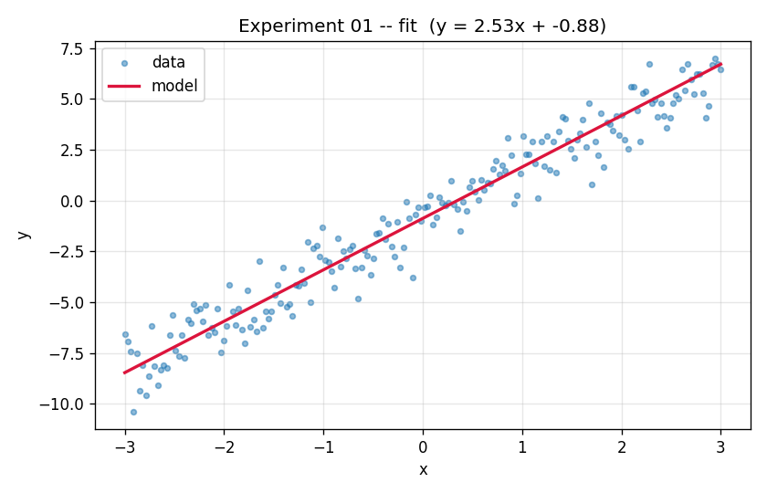
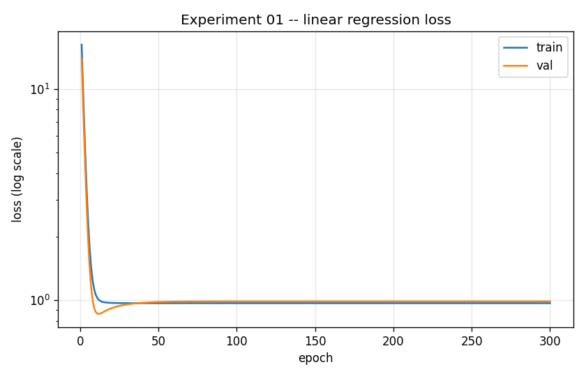

# Experiment 01 — Linear Regression

**Question:** Can a single linear layer recover a line from noisy data, and what
does the bare-minimum PyTorch training loop look like?

## Setup

| | |
|---|---|
| **Model** | `nn.Linear(1, 1)` — one weight (slope) + one bias (intercept) |
| **Data** | `y = 2.5·x − 1.0 + noise`, `x ∈ [-3, 3]`, Gaussian noise (σ=1.0) |
| **Loss** | Mean Squared Error (`nn.MSELoss`) |
| **Optimizer** | SGD, lr = 0.05 |
| **Epochs** | 300 (full-batch gradient descent) |

## Run

```bash
python experiments/01_linear_regression/train.py
# or tweak:
python experiments/01_linear_regression/train.py --epochs 400 --lr 0.1 --noise 0.5
```

## Results

| | |
|---|---|
| Fit |  |
| Loss |  |

Recovered parameters (seed 42): **w ≈ 2.53** (true 2.5), **b ≈ -0.88** (true -1.0).

## What to take away

- **A linear layer = linear regression.** `nn.Linear(1,1)` literally computes
  `w·x + b`; training just learns `w` and `b` by gradient descent.
- **The loss plateaus near ~1.0, not 0.** That floor is the *irreducible* error:
  the data has noise with variance σ²=1.0, and no line can fit noise. The model
  is doing as well as possible — a key intuition (you fit the signal, not the noise).
- **The five-step loop** (forward → loss → `zero_grad` → `backward` → `step`)
  is the same loop you will use for *every* model in this repo. Everything later
  is a bigger model or fancier data around this skeleton.
- **`zero_grad` is not optional:** PyTorch *accumulates* gradients into
  `param.grad`. Forget to reset and you sum gradients across epochs.

## Things to try

- Drop `--noise` to 0 → loss should head toward 0 and params hit the truth exactly.
- Raise `--lr` to ~0.5 → watch it converge faster; push higher and it diverges.
- This model **cannot** fit a curve. That limitation motivates the next
  experiment: a sine wave, where a single linear layer fails and a hidden layer
  with a nonlinearity is required.
