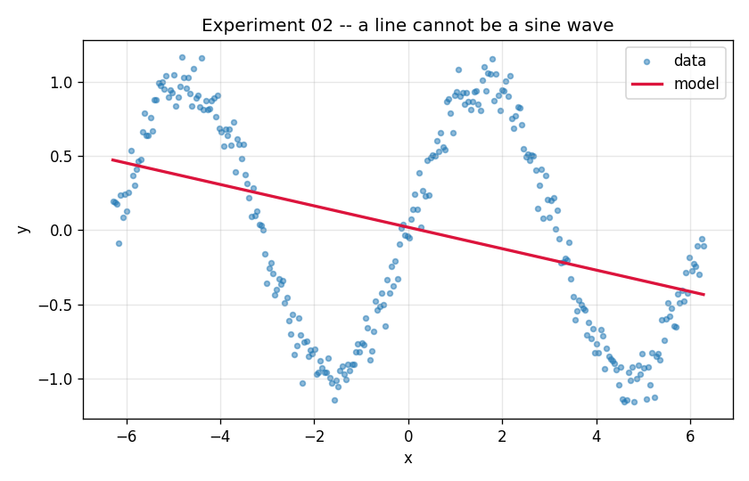

# Experiment 02 — Sine Wave with a Linear Layer (a deliberate failure)

**Question:** What happens when you point a linear model at a problem that
isn't linear?

## Setup

| | |
|---|---|
| **Model** | `nn.Linear(1, 1)` — same as experiment 01 |
| **Data** | `y = sin(x)`, `x ∈ [-2π, 2π]` (two periods), noise σ=0.1 |
| **Loss** | MSE · **Optimizer** Adam (lr 0.05) · **Epochs** 800 |

## Run

```bash
python experiments/02_sine_wave_linear/train.py
```

## Result



The loss flatlines at **~0.41** and never improves. The "best" line is nearly
horizontal — it has nothing useful to say about a curve.

## What to take away

- **A linear layer can only draw a straight line.** `w·x + b` has no way to bend.
  Train it forever and it still can't be a sine wave — this is a *capacity*
  limit, not an optimization or "more epochs" problem.
- **Why ~0.41?** Over whole periods, `sin(x)` has variance 0.5. A flat line at
  `y≈0` therefore scores about 0.5 in MSE; with our slight nonzero slope it lands
  near 0.41. That's the wall a linear model hits here.
- This failure is the entire motivation for experiment 03: add a hidden layer
  and a nonlinearity, and the same data becomes easy.

## Things to try

- More epochs / higher `lr` → confirms it's stuck. Capacity, not training time.
- Restrict the data to a single rising quarter-period (e.g. edit the range to
  `[-π/2, π/2]`) → a line approximates *that* reasonably, because it's nearly
  monotonic there.
