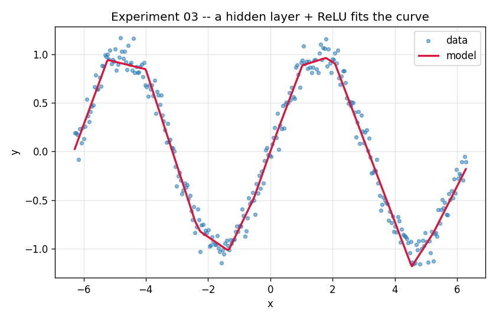

# Experiment 03 — Sine Wave with an MLP (nonlinearity to the rescue)

**Question:** Add one hidden layer and a nonlinearity to the failed model from
experiment 02 — can it now fit the curve?

## Setup

| | |
|---|---|
| **Model** | `Linear(1→64) → ReLU → Linear(64→1)` (193 params) |
| **Data** | identical to exp 02: `y = sin(x)`, `x ∈ [-2π, 2π]`, noise σ=0.1 |
| **Loss** | MSE · **Optimizer** Adam (lr 0.01) · **Epochs** 3000 |
| **Preprocessing** | standardize `x` using *train* statistics |

## Run

```bash
python experiments/03_sine_wave_mlp/train.py
python experiments/03_sine_wave_mlp/train.py --hidden 8    # watch it get coarser
```

## Result



Loss drops to **~0.010** — essentially the noise floor (σ²=0.01). The model
fit the signal; all that's left is the noise it *shouldn't* fit.

## What to take away

- **The ReLU is the whole trick.** Two linear layers with nothing between them
  collapse into one linear map (matrix × matrix = matrix) — that would be no
  better than exp 02. The nonlinearity *between* them is what unlocks curves.
- **Look closely at the fit:** it's made of short straight segments with kinks.
  That's literally how a ReLU network approximates a curve — by stitching
  together many "bent lines." More hidden units → more bends → smoother fit.
  This is the *universal approximation* idea made visible.
- **Why Adam + standardized input?** Raw `x ∈ [-6.28, 6.28]` trains slowly; Adam
  and zero-centered inputs are cheap, standard speed-ups. Try plain SGD on raw
  `x` to feel the difference.

## Things to try

- `--hidden 8` vs `--hidden 64` vs `--hidden 256` → capacity vs. smoothness.
- Drop `--noise` to 0 → val loss should approach 0.
- Push the data range wider (e.g. `[-4π, 4π]`) → more periods need more capacity.

## The arc (01 → 02 → 03)

| | model | data | outcome |
|---|-------|------|---------|
| 01 | linear | line | fits perfectly |
| 02 | linear | sine | **fails** (loss ~0.41) |
| 03 | MLP | sine | fits (loss ~0.01) |

The one variable that changed between 02 and 03 was *nonlinearity*. That's the
lesson.
