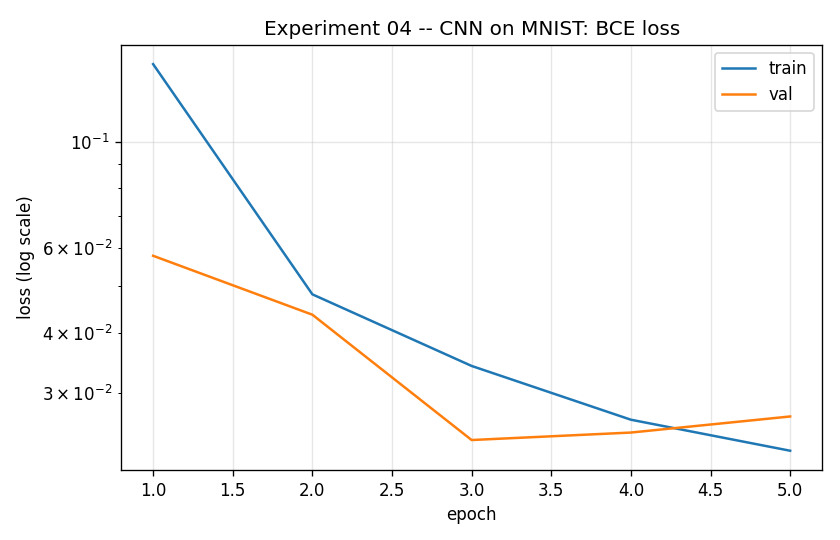
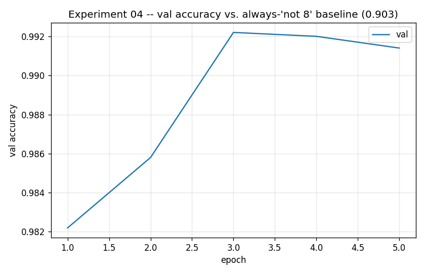
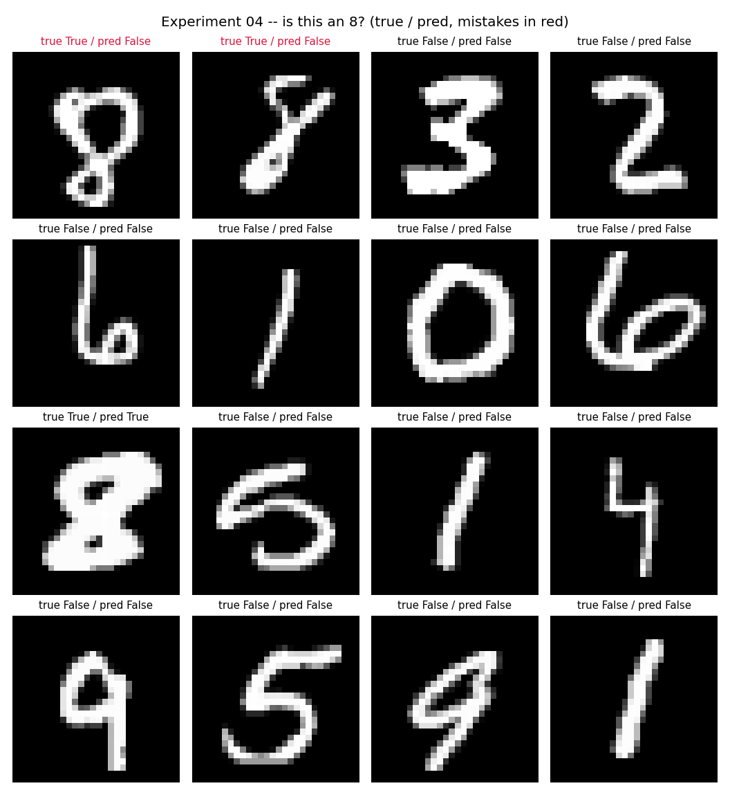

# Experiment 04 — MNIST CNN: Is This an 8?

**Question:** First real dataset, first CNN, first classification task. Can a
small conv net learn to recognize one specific digit — and does plain
accuracy actually tell us that, given only ~10% of MNIST is 8s?

## Setup

| | |
|---|---|
| **Model** | `Conv(1→8,3×3) → ReLU → MaxPool(2) → Conv(8→16,3×3) → ReLU → MaxPool(2) → Flatten → Linear(784→32) → ReLU → Linear(32→1)` (26,401 params) |
| **Data** | MNIST, binary label = `1` if digit is 8 else `0` (55k train / 5k val / 10k test) |
| **Loss** | `BCEWithLogitsLoss` (one logit, not 10-way softmax) · **Optimizer** Adam (lr 1e-3) · **Epochs** 5 |

## Run

```bash
python experiments/04_mnist_cnn_digit8/train.py
python experiments/04_mnist_cnn_digit8/train.py --pos-weight 9.0   # counter the 9:1 imbalance
```

## Result




| | accuracy | precision | recall |
|---|---|---|---|
| **always predict "not 8" baseline** | 0.9026 | — | 0.0 |
| **this model (test set)** | 0.9911 | 0.9933 | 0.9148 |



## What to take away

- **Accuracy alone can lie.** ~90% of MNIST is *not* 8, so a model that never
  fires still scores 90.3% "accuracy." The real signal here is that this CNN
  beats that baseline *and* has high precision/recall — it's actually finding
  8s, not just refusing to guess.
- **Precision vs. recall trade off.** Precision (0.993) means predicted-8s are
  almost always right; recall (0.915) means it still misses ~9% of real 8s —
  visible in the predictions grid as a true-8 mistaken for something else.
  `--pos-weight` in the loss lets you push that trade-off around: weighting
  the positive class higher trades some precision for more recall.
- **Convolutions vs. the earlier MLPs.** Experiments 01–03 treated inputs as
  flat vectors of independent numbers. A `Conv2d` instead slides a small
  learned filter across the image, so nearby pixels can vote together —
  that's what lets the model learn *shape* (the loop and crossbar of an 8)
  rather than memorizing pixel positions.

## Things to try

- `--pos-weight 9.0` → watch recall rise and precision dip as the loss leans
  harder into catching every 8.
- `--epochs 10` → val loss in the curve above already ticks back up after
  epoch 3 (mild overfitting) — more epochs should make that clearer.
- Swap `TARGET_DIGIT` in `train.py` for a harder digit (e.g. `4` vs `9`,
  which are visually closer) and compare precision/recall.

## The arc so far

| | model | data | outcome |
|---|-------|------|---------|
| 01 | linear | line | fits perfectly |
| 02 | linear | sine | **fails** (loss ~0.41) |
| 03 | MLP | sine | fits (loss ~0.01) |
| 04 | CNN | MNIST images | 99.1% test accuracy, but the baseline was already 90% — precision/recall are the real story |

First jump from synthetic 1D data to real images, and from regression to
classification. The next natural step is the full 10-way digit classifier.
