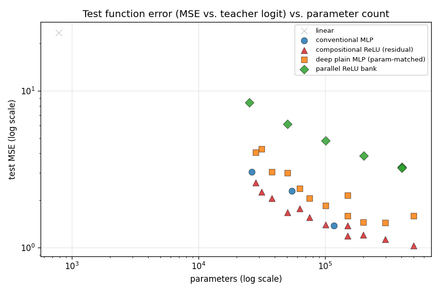
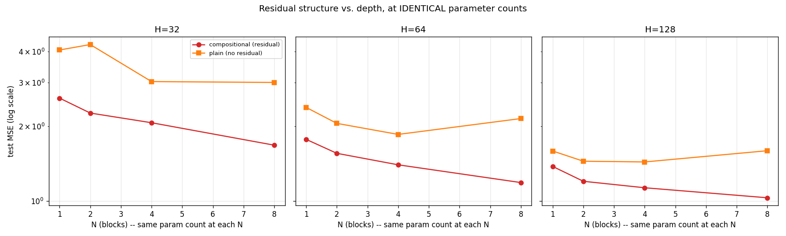

# Experiment 05 — Can a ReLU-Heavy MLP Represent a CNN's Learned Function?

**This is not an MNIST classification experiment.** The frozen CNN from
[experiment 04](../04_mnist_cnn_digit8/) is treated purely as a black-box
function `f_CNN(x) = logit`. A family of flat-vector students — with *no*
convolution, locality, weight sharing, or pooling — are trained to reproduce
that function:

```
image -> frozen CNN -> teacher logit -> [student MLP] -> predicted logit
```

Students are trained with `MSE(student_logit, teacher_logit)`. **The
original MNIST labels are never used as a training target** — only to
evaluate, afterward, whether reproducing the CNN's function also reproduces
its classification behavior.

## Hypothesis under test

> A complex input-output mapping can potentially be represented efficiently
> by a generic architecture with many simple nonlinear ReLU transformations,
> even without the inductive biases (convolution, locality, weight sharing,
> pooling) of the architecture that originally discovered the mapping.

Five architectures, all built from nothing but `nn.Linear` + `nn.ReLU`:

| # | Model | Idea being isolated |
|---|---|---|
| 1 | `LinearModel` | Is the function linearly separable at all? |
| 2 | `ConventionalMLP` (784→H→ReLU→H→ReLU→1) | Textbook shallow-MLP baseline |
| 3 | `DeepPlainMLP` | Same width/depth/params as #4, **no residual connections** |
| 4 | `CompositionalReLUMLP` | N residual blocks of `[Linear→ReLU]×3` |
| 5 | `ParallelReLUBank` | Many independent `Linear→ReLU` branches, concatenated |

The critical design choice (verified in `models.py`): for a given `(H, N)`,
`CompositionalReLUMLP(H, N)` and `DeepPlainMLP(H, n_layers=3N)` have
**exactly identical parameter counts** — same width, same total linear-layer
count. The only difference is the residual skip connection. Any metric gap
between them isolates that one structural choice, not "more weights."

## Pipeline

```bash
python experiments/05_function_distillation/generate_teacher_dataset.py  # cache CNN(x) for train/val/test
python experiments/05_function_distillation/sweep.py                     # train all 34 students, -> outputs/results.csv
python experiments/05_function_distillation/robustness_eval.py           # perturbation generalization, -> outputs/robustness_results.csv
python experiments/05_function_distillation/worst_case.py --model compositional_H128_N8
python experiments/05_function_distillation/make_plots.py                # -> outputs/plots/
```

`teacher.py` reuses experiment 04's `CNN` class and exact 55k/5k/10k split
(same seed) by dynamically loading its `train.py` — no CNN code duplicated.
`generate_teacher_dataset.py` runs every image through the frozen CNN once
and caches `(image, logit, prob, label)` per split, so all 34 student runs
share one teacher-inference pass instead of repeating it.

## Sweep: 34 student configs

- **Baselines:** 1 linear, 3 conventional MLP (H ∈ {32,64,128})
- **Core grid:** `compositional_relu` × `deep_plain_mlp`, paired at H ∈
  {32,64,128} × N ∈ {1,2,4,8} — 12 parameter-matched pairs (24 models)
- **Parallel bank:** 6 configs spanning a similar parameter range (25k–402k),
  including two configs with *identical* params but opposite branch shape
  (32 branches × 16 wide vs 16 branches × 32 wide)

10 epochs, Adam (lr 1e-3), seed 42, MSE loss against the teacher logit.

## Results

Full numbers: [outputs/results.csv](outputs/results.csv). Headline plots:




| model | params | ReLU layers | train MSE | val MSE | test MSE | test agreement w/ teacher |
|---|---|---|---|---|---|---|
| linear | 785 | 0 | 23.58 | 23.14 | 23.55 | 0.9240 |
| conventional_mlp_H128 | 117,121 | 2 | 0.99 | 1.39 | 1.38 | 0.9951 |
| deepplain_H128_N8 | 496,897 | 24 | 1.26 | 1.59 | 1.60 | 0.9939 |
| **compositional_H128_N8** | 496,897 | 24 | **0.67** | **1.05** | **1.03** | **0.9957** |
| parallel_B16_W32 | 402,433 | 16 | 3.01 | 3.42 | 3.26 | 0.9815 |

(Teacher logits range roughly ±32, so an MSE of ~1 means predictions are
typically within ~1 of the CNN's own logit; MSE ~23 for the linear model
means it's barely tracking the function at all.)

### The core ablation: residual structure vs. depth, at identical params

At **every** `(H, N)` pair, `compositional_relu` beats its exact
parameter-matched `deep_plain_mlp` twin — and the gap widens with `N`:

| H | N | params (both) | compositional test MSE | plain test MSE | plain's fate |
|---|---|---|---|---|---|
| 32 | 1 | 28,321 | 2.60 | 4.06 | |
| 32 | 8 | 50,497 | 1.68 | 3.01 | plateaus |
| 64 | 4 | 100,225 | 1.40 | 1.86 | |
| 64 | 8 | 150,145 | 1.19 | 2.15 | **gets worse than N=4** |
| 128 | 4 | 298,753 | 1.13 | 1.44 | |
| 128 | 8 | 496,897 | 1.03 | 1.60 | **gets worse than N=4** |

The plain stack doesn't just lag — at H=64 and H=128 it actually gets
*worse* going from N=4 to N=8 blocks (12→24 linear layers), the textbook
"plain deep networks degrade with depth" pathology that residual
connections were invented to fix (He et al., 2015) — reproduced here at
toy scale, for a distillation target rather than a classification loss.
Compositional, with identical parameters, keeps improving monotonically
through N=8.

### Parallel bank underperforms both

`parallel_bank` is the weakest architecture at every parameter budget
tested — worse test MSE *and* worse teacher agreement than a same-sized
conventional MLP, plain MLP, or compositional model. `parallel_B32_W16` and
`parallel_B16_W32` have identical parameter counts (402,433) and nearly
identical results (3.23 vs 3.26 test MSE) — branch shape barely matters;
what limits this architecture is that every branch sees only the raw
784-dim input. Nothing in the model can build features *on top of* other
learned features — there's no composition, only parallel generation
followed by one linear combination. That appears to matter more than
sheer nonlinear-unit count.

### Generalization (train vs. val vs. test)

No sign of memorization anywhere in the sweep: val and test MSE track each
other closely for every model (e.g. compositional_H128_N8: val 1.045, test
1.032), and the train→val gap, while present (0.67→1.05), is modest and
consistent with ordinary generalization, not overfitting to specific
training images. See `outputs/results.csv` for train/val/test on every
config.

### Robustness beyond the training manifold

Test images perturbed with small translation, rotation, Gaussian noise, and
brightness shifts, then compared via `CNN(x') ` vs `student(x')` on the
*same* modified image ([outputs/robustness_results.csv](outputs/robustness_results.csv)):

| model | clean MSE | translate 2px | rotate 10° | gaussian noise | brightness 1.3x |
|---|---|---|---|---|---|
| linear | 22.9 | 54.7 | 24.2 | 78.4 | 25.9 |
| conventional_mlp_H128 | 1.44 | 6.03 | 1.89 | **4.42** | 1.66 |
| deepplain_H128_N8 | 1.54 | 8.14 | 1.90 | 11.25 | 1.89 |
| **compositional_H128_N8** | **0.99** | **5.88** | **1.42** | 6.48 | **1.16** |
| parallel_B32_W16 | 3.05 | 7.03 | 3.03 | **4.92** | 3.34 |

Every model degrades substantially off the clean-test manifold (2–8x MSE
increase) — this is a real effect of the *teacher's* own sensitivity to
these perturbations (the CNN was never trained to be translation/noise
invariant beyond what 2 rounds of max-pooling buys it), compounded by
student approximation error. Compositional keeps its lead on translation,
rotation, and brightness — but **not** on Gaussian noise, where the
plain conventional MLP and even the weaker parallel bank score *better*
than the compositional model, and the parameter-matched plain MLP is
worst of all. A plausible read: more stacked layers (even with residual
paths) give per-pixel noise more opportunities to compound before the
final layer, partially offsetting the architecture's clean-function
advantage. This is a genuine mixed result, not a clean win for the
hypothesis.

### Where the student is wrong

`outputs/worst_cases/compositional_H128_N8_worst_cases.png` shows the 16
test images with the largest `|CNN_logit - MLP_logit|`. 14 of 16 are cases
where teacher and student **agree on the classification** ("not an 8") but
disagree sharply on magnitude — almost all are examples where the CNN
itself is extremely confident (logit around -10 to -17), out in the sparse
tail of the target distribution the MSE loss under-weights relatively
(most training logits cluster closer to the decision boundary). The other
2/16 are genuine classification disagreements, and both occur on *actual*
8s where the CNN itself is barely confident (logit ≈ -1.1 and ≈ +0.2) —
exactly where you'd expect approximation error to have real classification
consequences. A dead-ReLU-fraction probe of the compositional model's 8
residual blocks found no meaningful difference between the worst-case batch
and a batch of median-error examples (fractions match within ~0.02 at every
block) — errors don't appear to localize to a specific under-used part of
the representation, at least by this simple sparsity lens.

## Scientific interpretation

1. **Can a ReLU-heavy MLP reproduce the CNN function?** Reasonably well.
   The best student (compositional, H=128, N=8) reaches test MSE ≈ 1.03 on
   a target ranging roughly ±32, 99.57% classification agreement with the
   teacher, and clean train/val/test consistency — clearly *not* just
   memorizing training images.
2. **How much capacity does it require?** Surprisingly little to beat the
   "is it fundamentally beyond a flat representation" bar: even the
   smallest conventional MLP (H=32, 26k params) reaches 99% agreement.
   Closing the remaining gap to the CNN's own precision takes far more —
   the best model uses ~500k params, roughly 19x the teacher's 26.4k.
3. **Does increasing the number of ReLU transformations improve function
   approximation?** Yes, but only *with* the residual structure. For
   `compositional_relu`, more blocks (more ReLU transformations) reliably
   lowered test error at every width tested. For `deep_plain_mlp` at the
   same depths, more transformations sometimes made things *worse*
   (N=4→N=8 at H=64 and H=128).
4. **Does it outperform a parameter-matched conventional MLP?** Yes — e.g.
   compositional_H128_N8 (1.03 test MSE, 497k params) beats
   conventional_mlp_H128 (1.38 test MSE, 117k params) even though the
   conventional model has fewer parameters; at closer to matched params
   the gap is smaller but compositional still leads throughout the grid.
5. **Does the parallel ReLU feature bank behave differently from the deep
   compositional version?** Yes, clearly — it's the worst-performing
   architecture at every parameter budget tested, both on test MSE and
   teacher agreement. Diverse simultaneous nonlinear features without
   composition were not an effective substitute for depth here.
6. **Does the MLP generalize to inputs it wasn't trained on?** To held-out
   MNIST-distribution images, yes (train/val/test track closely). To
   inputs *off* that distribution (translated, rotated, noised, brightness
   -shifted), no model holds up as well as on clean test data — though
   compositional degrades the least on 3 of 4 perturbation types.
7. **Is the improvement caused by more parameters/FLOPs, or by the ReLU
   structure itself?** The H×N grid directly controls for this:
   compositional and deep-plain models are **exactly parameter- and
   FLOP-matched** at every grid point, and compositional wins throughout —
   so at least part of the advantage is attributable to the residual
   structure itself, not raw capacity. That said, params/FLOPs still
   explain most of the *overall* variance across all 34 models (see
   `test_error_vs_params.png`) — architecture is a second-order effect on
   top of a strong capacity trend, not a replacement for it.
8. **Does the experiment support or contradict the hypothesis?** Partial,
   qualified support. A generic ReLU-heavy architecture with no
   convolutional inductive bias *can* closely approximate this CNN's
   learned function and largely recover its classification behavior —
   supporting the core claim. But the *specific* mechanism matters a lot:
   composition-with-residuals clearly beats both plain depth and parallel
   width at matched capacity, so "many simple nonlinear transformations"
   is not sufficient by itself — *how* they're arranged (composed serially
   with residual paths, vs. stacked plainly, vs. generated in parallel)
   changes the result substantially. And the robustness results show the
   representation learned is not fully equivalent to the CNN's — it
   degrades differently, and sometimes worse, off the training
   distribution. The hypothesis is not proven; it is supported in its
   weak form (a generic architecture *can* work) and contradicted in its
   strong form (that ReLU transformation *count* alone, independent of
   structure, is what matters).

## Reproducing this

```bash
python experiments/05_function_distillation/generate_teacher_dataset.py
python experiments/05_function_distillation/sweep.py
python experiments/05_function_distillation/robustness_eval.py
python experiments/05_function_distillation/worst_case.py --model compositional_H128_N8
python experiments/05_function_distillation/make_plots.py
```

Fixed seed (42) throughout. Everything under `outputs/` is regenerable from
these five commands and experiment 04's checkpoint — `outputs/cache/`,
`outputs/checkpoints/`, and `*.pt` files are gitignored; `results.csv`,
`robustness_results.csv`, worst-case CSVs/images, and `plots/*.png` are
committed so the results render on GitHub without rerunning anything.

## Things to try

- Longer training / LR schedule — 10 epochs was enough to separate
  architectures cleanly but val MSE was often still (slowly) falling.
- A `compositional_relu` × `parallel_bank` hybrid: residual blocks whose
  internal transformation is itself a parallel bank.
- Repeat the Gaussian-noise robustness result with multiple noise seeds —
  it's the one place the hypothesis's predicted winner didn't win, and a
  single-seed result deserves a second look before trusting it.
- Distill a *harder* teacher (e.g. the full 10-way digit classifier) to see
  whether the residual-vs-plain gap grows with the function's complexity.
