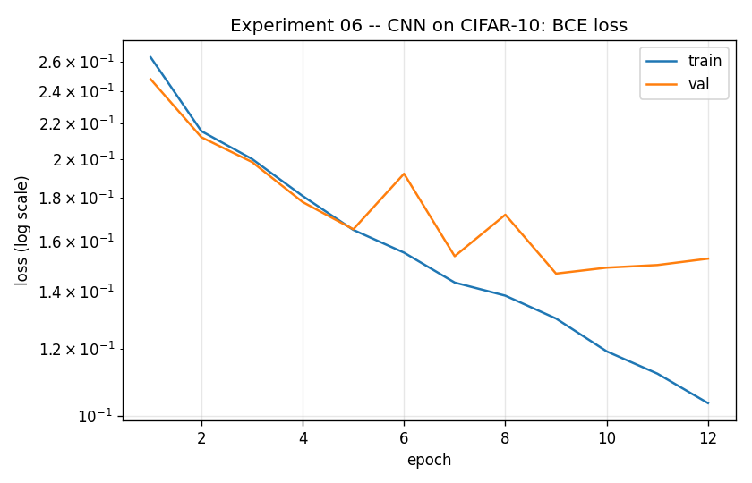
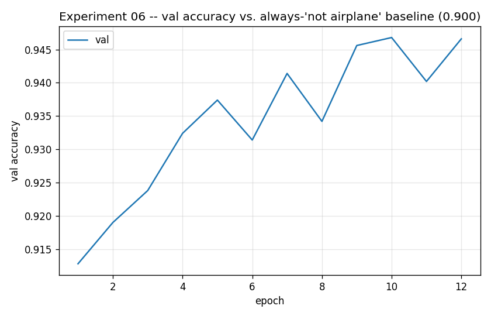
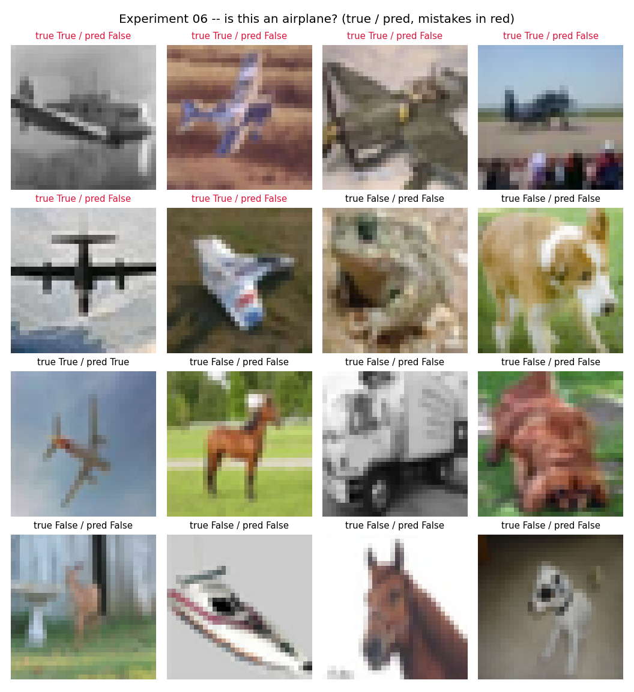

# Experiment 06 — CIFAR-10 CNN: Is This an Airplane?

**Question:** The RGB, harder-dataset sequel to [experiment 04](../04_mnist_cnn_digit8/)
(MNIST digit-8). Same binary framing and the same reason for it — airplane
is exactly 1 of 10 balanced CIFAR-10 classes, so ~10% of the data is
positive and a model that always says "no" still scores ~90% accuracy. Can
a small CNN beat that baseline on real photographs, not clean handwritten
digits?

This CNN also exists to be [experiment 07](../07_function_distillation_cifar10/)'s
distillation **teacher** — how good it is here directly shapes what the
student models in that experiment can learn.

## A build note: the standard CIFAR-10 download was broken

`torchvision.datasets.CIFAR10` only knows one source (a University of
Toronto server). It stalled completely after ~50MB and never recovered,
then crawled at <15kB/s even with retries — general network speed to other
hosts tested fine at ~100kB/s, so this was specific to that one server.
[`cifar10_data.py`](cifar10_data.py) sources the identical images/labels
from Hugging Face's CDN instead (~6-8MB/s) as two parquet files, decodes
them once into a cached tensor, and exposes the same
`(PIL image, label)` + `.targets` interface `torchvision.datasets.CIFAR10`
does — confirmed same label ordering (0=airplane, ..., 9=truck) via the
parquet's embedded metadata. Nothing downstream needed to change.

## Setup

| | |
|---|---|
| **Model** | `Conv(3→16,3×3) → ReLU → MaxPool(2) → Conv(16→32,3×3) → ReLU → MaxPool(2) → Conv(32→64,3×3) → ReLU → MaxPool(2) → Flatten → Linear(1024→64) → ReLU → Linear(64→1)` (89,249 params) |
| **Data** | CIFAR-10, binary label = `1` if class is airplane else `0` (45k train / 5k val / 10k test) |
| **Loss** | `BCEWithLogitsLoss` (one logit) · **Optimizer** Adam (lr 1e-3) · **Epochs** 12 |
| **Preprocessing** | `ToTensor()` only — no normalization, no augmentation (kept deliberately simple, same as experiment 04) |

One conv block more than experiment 04's MNIST CNN (3 vs. 2) — CIFAR-10
needs more capacity to separate real photographs than MNIST needs for
clean handwritten strokes on black.

## Run

```bash
python experiments/06_cifar10_cnn_airplane/train.py
python experiments/06_cifar10_cnn_airplane/train.py --pos-weight 9.0   # counter the 9:1 imbalance
```

## Result




| | accuracy | precision | recall |
|---|---|---|---|
| **always predict "not airplane" baseline** | 0.9000 | — | 0.0 |
| **this model (test set)** | 0.9486 | 0.8716 | 0.5700 |



## What to take away

- **Real photographs are genuinely harder than clean digits.** Experiment
  04's MNIST CNN reached 99.1% test accuracy with 2 conv blocks and 5
  epochs; this one needs a 3rd block and still lands at 94.9% — clearly
  above the 90% baseline, but with real room left. Recall (0.57) is the
  weak point: it misses close to half of actual airplanes, generally the
  ones photographed at odd angles, partially occluded, or against a sky
  that confuses easily with "bird" or "ship."
- **The val loss curve shows mild overfitting** starting around epoch 9
  (val loss ticks back up while train loss keeps falling) — expected with
  no data augmentation on a harder, more visually diverse dataset. `--epochs
  8` or adding augmentation would likely help; left as-is here to keep the
  experiment simple and match experiment 04's style.
- **`--pos-weight`** works the same way it did in experiment 04 — push it
  above 1.0 to trade precision for recall if missing airplanes matters more
  than false positives.

## Things to try

- `--pos-weight 4.0` or higher → should meaningfully improve recall at some
  precision cost, worth comparing against the unweighted run above.
- Add `transforms.Normalize` with CIFAR-10's channel mean/std — the model
  currently trains on raw `[0,1]` pixels; per-channel normalization is a
  standard, cheap accuracy boost for RGB photographs.
- `--epochs 20` with a LR schedule, to see how far the current architecture
  can go before really needing augmentation.

## The arc so far

| | model | data | outcome |
|---|-------|------|---------|
| 04 | 2-block CNN | MNIST (grayscale digits) | 99.1% test accuracy vs. 90.3% baseline |
| **06** | 3-block CNN | CIFAR-10 (RGB photographs) | 94.9% test accuracy vs. 90.0% baseline — harder data, real gap |

This CNN is the frozen teacher for
[experiment 07](../07_function_distillation_cifar10/), which repeats
experiment 05's function-distillation study — can a flat ReLU-MLP with no
convolutional bias learn *this* CNN's function? — against a harder, more
demanding teacher than experiment 05's MNIST one.
