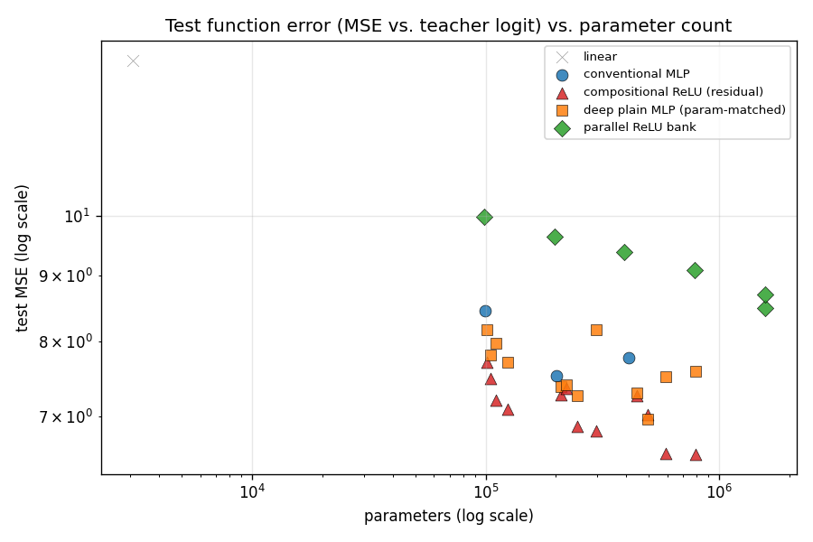
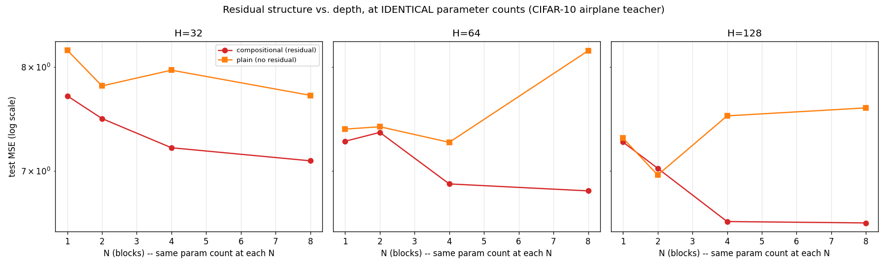

# Experiment 07 — Function Distillation, Repeated on a Harder Teacher (CIFAR-10 Airplane CNN)

Experiment 05's exact study — can a ReLU-heavy MLP with no convolutional
bias represent a CNN's learned function? — repeated against a different,
harder teacher: [experiment 06](../06_cifar10_cnn_airplane/)'s CIFAR-10
"is this an airplane?" CNN, instead of experiment 04's MNIST digit-8 CNN.
Same five student architectures, same H×N grid, same parameter-matching
design, same pipeline — only the teacher and input dimensionality (3072
flat pixels, 32×32×3, instead of 784) differ. Read
[experiment 05's README](../05_function_distillation/README.md) first for
the full architecture rationale; this one focuses on what changed, and
whether the earlier findings hold up against a harder function.

```
image -> frozen CIFAR-10 airplane CNN -> teacher logit -> [student MLP] -> predicted logit
```

Students train on `MSE(student_logit, teacher_logit)` only — the CIFAR-10
label is never a training target, only used afterward to evaluate task
performance.

## Why repeat it on CIFAR-10?

Experiment 06's CNN is a meaningfully harder, noisier teacher than
experiment 04's: 94.9% test accuracy vs. 99.1%, real photographs instead of
clean strokes on black, and a narrower, noisier logit range. If experiment
05's findings (residual composition beats parameter-matched plain depth;
parallel width underperforms both) were an artifact of MNIST being
unusually easy or clean, they should weaken or disappear here. If they
hold up on a harder, differently-structured function, that's real evidence
the mechanism generalizes.

## Pipeline

Identical to experiment 05, run against experiment 06's checkpoint:

```bash
python experiments/07_function_distillation_cifar10/generate_teacher_dataset.py
python experiments/07_function_distillation_cifar10/sweep.py
python experiments/07_function_distillation_cifar10/robustness_eval.py
python experiments/07_function_distillation_cifar10/worst_case.py --model compositional_H128_N8
python experiments/07_function_distillation_cifar10/make_plots.py
```

`teacher.py` dynamically loads experiment 06's `train.py` (including its
`cifar10_data.CIFAR10HF` loader) the same way experiment 05's loads
experiment 04's — no CNN or data-loading code duplicated. 34 student
configs, 10 epochs, Adam (lr 1e-3), seed 42, MSE against the teacher logit.

## Results

Full numbers: [outputs/results.csv](outputs/results.csv).




| model | params | ReLU layers | train MSE | val MSE | test MSE | test agreement w/ teacher |
|---|---|---|---|---|---|---|
| linear | 3,073 | 0 | 13.37 | 13.05 | 13.18 | 0.9347 |
| conventional_mlp_H128 | 409,985 | 2 | 7.59 | 8.06 | 7.78 | 0.9453 |
| deepplain_H128_N8 | 789,761 | 24 | 7.38 | 7.89 | 7.59 | 0.9470 |
| **compositional_H128_N8** | 789,761 | 24 | **5.95** | 6.92 | **6.55** | **0.9536** |
| **compositional_H128_N4** | 591,617 | 12 | 6.11 | **6.71** | 6.56 | 0.9500 |
| parallel_B32_W16 | 1,573,889 | 32 | 8.46 | 9.05 | 8.70 | 0.9455 |

(Teacher logits range roughly ±22 here, narrower than MNIST's ±32 but the
function is harder to fit — note the best CIFAR-10 test MSE, 6.55, is a
much larger *fraction* of its target's range than MNIST's best, 1.03 of
±32. This teacher's function is genuinely harder to approximate, not just
differently scaled.)

### The core ablation, replicated: residual structure vs. depth at identical params

Same result as experiment 05, on a different teacher: at nearly every
`(H, N)` pair, `compositional_relu` beats its exact parameter-matched
`deep_plain_mlp` twin, and the "plain gets worse with more depth" pathology
is, if anything, **more pronounced** here:

| H | N | params (both) | compositional test MSE | plain test MSE |
|---|---|---|---|---|
| 64 | 1 | 209,217 | 7.27 | 7.39 |
| 64 | 4 | 246,657 | 6.89 | 7.26 |
| 64 | 8 | 296,577 | 6.83 | **8.17 (worse than N=1!)** |
| 128 | 2 | 492,545 | 7.03 | 6.97 (a rare exception — plain edges ahead) |
| 128 | 4 | 591,617 | 6.56 | 7.52 |
| 128 | 8 | 789,761 | 6.55 | **7.59 (worse than N=2!)** |

At H=64 and H=128, the plain model's test MSE at N=8 is *worse than at
N=1* — going from 3 to 24 linear layers with no residual path actively
hurt it. Compositional, at the same parameter counts, kept improving (or
held flat) all the way to N=8. The one exception in the table (H=128,
N=2) is a reminder this isn't a law of nature — compositional wins
*almost* everywhere, not literally everywhere, and that "almost" is more
honest than claiming a universal rule.

### Parallel bank underperforms again, more starkly

`parallel_bank` is again the weakest family at every budget — and the gap
is wider than on MNIST. The largest parallel model tested,
`parallel_B32_W16` (1,573,889 params — 2x compositional's best), reaches
only 8.70 test MSE, clearly worse than `compositional_H32_N8`'s 7.09 at
**13x fewer parameters** (123,713). Nonlinear width without composition
scales particularly poorly on this harder teacher.

### Generalization and diminishing returns

Train/val/test stay reasonably close for every model (e.g.
compositional_H128_N8: 5.95 / 6.92 / 6.55) — no memorization. But unlike
MNIST, where the largest compositional model was clearly the best,
**CIFAR-10 shows a plateau**: `compositional_H128_N4` (591,617 params, test
MSE 6.56) is statistically indistinguishable from `compositional_H128_N8`
(789,761 params, test MSE 6.55) — an extra 198k parameters bought
essentially nothing. This is a plausible sign the *teacher's own function*
has a harder floor here (a real photograph classifier probably encodes
more genuinely irreducible ambiguity than a digit classifier), not that
composition stopped helping in general — the H=64 and H=32 rows still show
clean, if smaller, gains from N=4 to N=8.

### Robustness beyond the training manifold

Same four perturbations as experiment 05, evaluated on `CNN(x')` vs.
`student(x')` for the same modified image
([outputs/robustness_results.csv](outputs/robustness_results.csv)):

| model | clean MSE | translate 2px | rotate 10° | gaussian noise | brightness 1.3x |
|---|---|---|---|---|---|
| linear | 13.88 | 28.52 | 23.48 | 15.64 | 19.21 |
| conventional_mlp_H128 | 8.28 | 13.23 | 10.30 | 9.64 | 11.06 |
| deepplain_H128_N8 | 8.05 | 11.48 | 11.32 | 11.41 | 10.63 |
| **compositional_H128_N8** | **6.83** | **10.66** | **9.16** | 11.33 | **9.23** |
| parallel_B32_W16 | 8.79 | 12.26 | 13.44 | 15.11 | 10.46 |

Same qualitative pattern as MNIST: compositional keeps its lead on
translation, rotation, and brightness, but **not** on Gaussian noise, where
it's essentially tied with (and no better than) the plain and parallel
models. Two-for-two now on this specific exception — worth taking
seriously as a real, repeatable limitation rather than a fluke from one
teacher.

### Where the student is wrong: a real difference from MNIST

`outputs/worst_cases/compositional_H128_N8_worst_cases.png` shows the 16
largest `|CNN_logit - MLP_logit|` disagreements. **5 of 16 are genuine
classification flips** (marked in red) — a much higher fraction than
MNIST's 2/16. Several are real airplane photos the CNN correctly (if not
always confidently) identified that the student confidently got wrong: a
red toy plane against a lawn, a small airliner on a runway, a green toy
plane on a light background. These don't look like "hard" cases to a
human, but they're visually atypical airplane instances (toy models,
unusual framing) — exactly the kind of distributional edge case a harder,
more visually diverse dataset produces more of. The dead-ReLU-fraction
probe again found no meaningful difference between worst-case and
typical-error batches (within ~0.02 at every block, same as MNIST) — this
experiment offers no evidence that errors localize to a specific
under-used part of the representation, on either teacher.

## Ground-truth task evaluation (smallest true MLP)

Mirroring experiment 05's ground-truth check, `evaluate_ground_truth.py`
against the real "is this an airplane?" label — run for both the smallest
true MLP and the best (largest) student, to see whether extra capacity
closes the gap or just shrinks it:

| model | params | test accuracy | precision | recall |
|---|---|---|---|---|
| baseline (always "not airplane") | — | 0.9000 | — | 0.0 |
| teacher CNN | 89,249 | 0.9486 | 0.8716 | 0.5700 |
| conventional_mlp_H32 (smallest true MLP) | 99,425 | 0.9089 | 0.8248 | 0.1130 |
| **compositional_H128_N8 (best student)** | 789,761 | **0.9254** | 0.7309 | **0.4020** |

The smallest MLP keeps only 0.113 of the teacher's already-modest 0.570
recall (19.8%) — a much bigger collapse than MNIST's smallest-MLP result,
which kept 0.844 of its teacher's recall. Going to the best student (8.8x
more capacity than the teacher itself) recovers most of that gap — 70.5%
of teacher recall — but at a real precision cost (0.873 → 0.731): the
bigger model catches far more real airplanes but with more false
positives, and even at 789k params it doesn't fully close the recall gap.
Capacity clearly helps recover this harder teacher's positive-class
behavior, but distillation alone — even a lot of it — doesn't fully
recover task performance the way it nearly did on MNIST.

## Scientific interpretation — does this replicate experiment 05?

1. **Residual composition beats parameter-matched plain depth** — yes,
   replicated, and the "plain gets worse with depth" pathology is more
   pronounced here (H=64 and H=128 both show N=8 *worse than* N=1 for the
   plain model).
2. **Parallel width underperforms both, at every budget** — yes,
   replicated, and the gap is wider (13x fewer params beats the largest
   parallel model tested).
3. **Gaussian-noise robustness is the one place compositional doesn't
   win** — yes, replicated in the same specific way, now on two unrelated
   teachers. This looks like a real, structural limitation of the residual
   architecture's noise sensitivity, not a fluke.
4. **What's different:** CIFAR-10 shows earlier diminishing returns
   (H=128's N=4 and N=8 are statistically tied) and a much sharper
   ground-truth recall collapse at small student capacity — both consistent
   with this teacher's function being genuinely harder to approximate, not
   just differently scaled. The worst-case analysis also surfaced real
   classification errors (5/16) far more often than MNIST did (2/16),
   suggesting harder/more visually diverse input domains cost the student
   real task accuracy, not just logit-magnitude precision.
5. **Overall:** the core structural claims from experiment 05 hold up
   under a genuine replication attempt on an unrelated, harder teacher —
   that's meaningfully stronger evidence than a single experiment. The
   hypothesis remains supported in its weak form (a non-convolutional
   architecture can represent the function) and unsupported in its strong
   form (transformation count alone, independent of structure, matters) —
   same qualified verdict as experiment 05, now cross-validated.

## Reproducing this

```bash
python experiments/06_cifar10_cnn_airplane/train.py            # train the teacher first
python experiments/07_function_distillation_cifar10/generate_teacher_dataset.py
python experiments/07_function_distillation_cifar10/sweep.py
python experiments/07_function_distillation_cifar10/robustness_eval.py
python experiments/07_function_distillation_cifar10/worst_case.py --model compositional_H128_N8
python experiments/07_function_distillation_cifar10/evaluate_ground_truth.py --model conventional_mlp_H32
python experiments/07_function_distillation_cifar10/make_plots.py
```

Fixed seed (42) throughout. `outputs/cache/`, `outputs/checkpoints/`, and
`*.pt` files are gitignored and regenerable; `results.csv`,
`robustness_results.csv`, worst-case CSVs/images, ground-truth CSVs, and
`plots/*.png` are committed.

**A build note on wall-clock times in `results.csv`:** two configs
(`compositional_H32_N1` at 647s, `deepplain_H32_N4` at 2,335s) show wildly
inflated `train_time_sec` compared to same-sized neighbors that ran in
15-30s — this machine hit unrelated system-level stalls during the sweep
(confirmed by comparing against architecturally near-identical configs
that ran normally), not a real cost of those specific configs. Trust
`flops_per_sample` over `train_time_sec` for compute comparisons here.

## Things to try

- Everything from experiment 05's list, plus: add `transforms.Normalize`
  to the CIFAR-10 teacher (experiment 06) and see whether a cleaner,
  higher-accuracy teacher produces an easier-to-distill function.
- Repeat with a *harder* target class than airplane (e.g. "cat" — visually
  more variable, likely a noisier teacher function) to see if the recall
  collapse and worst-case classification-flip rate get worse again.
- The H=128,N=2 exception where plain edged out compositional deserves a
  multi-seed check before treating either result as reliable at that one
  grid point.
