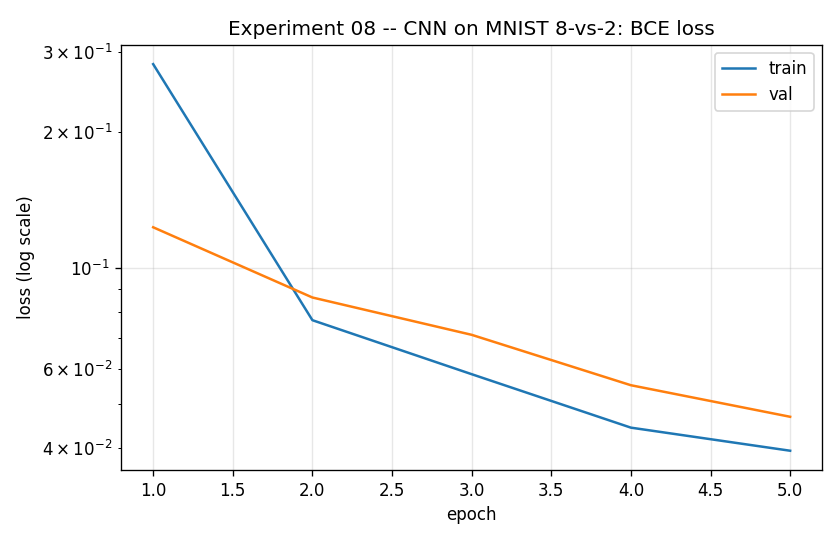
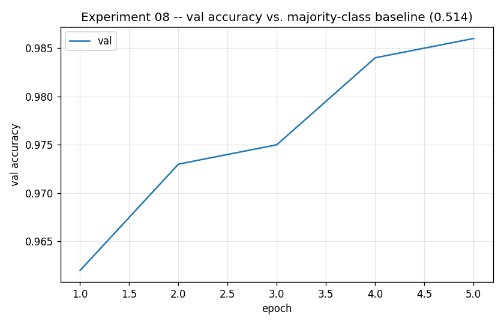
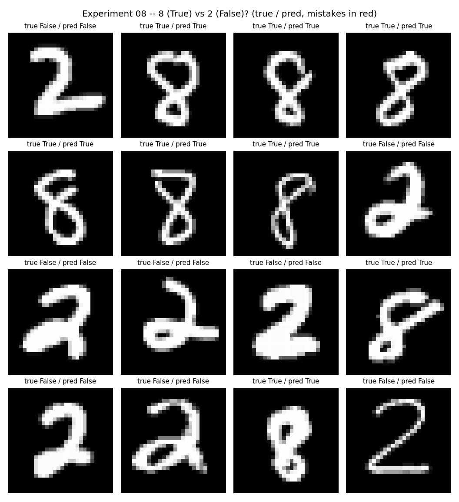

# Experiment 08 — MNIST CNN: 8 vs. 2

**Question:** Experiment 04 asked "is this an 8?" across all of MNIST — a
task where ~90% of images are negatives, so a model that always says "no"
already scores ~90% accuracy. This experiment removes that shortcut
entirely: the dataset is filtered down to **only** digits 8 and 2 before
training, giving a genuinely balanced task (~49.5%/50.5%). A model that
always guesses one class now scores ~50%, not ~90% — accuracy here has to
reflect real discriminative ability.

8 and 2 aren't an arbitrary pair: both can have a closed loop depending on
handwriting style, and both share a curved lower stroke — a plausibly
*harder* pair than "8 vs. everything," where "everything" includes easy
digits like 1 or 7.

## Setup

| | |
|---|---|
| **Model** | Identical to experiment 04: `Conv(1→8,3×3) → ReLU → MaxPool(2) → Conv(8→16,3×3) → ReLU → MaxPool(2) → Flatten → Linear(784→32) → ReLU → Linear(32→1)` (26,401 params) |
| **Data** | MNIST filtered to digits {2, 8} only. Label = `1` if 8, else `0`. 10,809 train / 1,000 val / 2,006 test |
| **Loss** | `BCEWithLogitsLoss` · **Optimizer** Adam (lr 1e-3) · **Epochs** 5 |

Same architecture as experiment 04 on purpose — this experiment is about
the *data* (balanced pairwise comparison vs. imbalanced one-vs-rest), not
the model.

## Run

```bash
python experiments/08_mnist_cnn_8_vs_2/train.py
```

## Result




| | accuracy | precision | recall |
|---|---|---|---|
| **majority-class baseline** | 0.5145 | — | — |
| **this model (test set)** | 0.9920 | 0.9878 | 0.9959 |



## What to take away

- **Balance alone didn't make the task harder for the CNN.** Despite 8 and
  2 sharing some visual structure, this model actually reaches slightly
  *higher* test accuracy (99.20%) than experiment 04's one-vs-rest task
  (99.11%) — shared strokes between two specific digits are apparently
  easier for a CNN to separate than "one digit vs. nine other digits
  combined," at least for this pair.
- **The metric story is completely different from experiment 04's.**
  There, accuracy alone was misleading (a do-nothing baseline scored 90%)
  and precision/recall told the real story. Here, the baseline is ~51% and
  accuracy is directly meaningful — precision and recall barely add
  information beyond it (both ~0.99, tracking accuracy closely), because
  there's no majority-class shortcut left to expose.
- **This is the point of the comparison.** Experiment 04's imbalanced task
  and this balanced one look similar (same CNN, same loss, similar final
  accuracy) but stress completely different things: one tests whether a
  model can beat a lazy baseline, the other tests raw discriminative
  ability between two specific, chosen classes.

## Things to try

- A harder digit pair — e.g. 4 vs. 9, or 3 vs. 8 — to see whether balance
  alone or *specific pair difficulty* is what drives accuracy down.
- Compare the confusion patterns (which 8s get called 2, and vice versa)
  to experiment 04's false negatives on 8.

## The arc so far

| | model | data | outcome |
|---|-------|------|---------|
| 04 | 2-block CNN | MNIST, 8-vs-rest (imbalanced ~90/10) | 99.1% accuracy vs. 90.3% baseline |
| **08** | 2-block CNN | MNIST, 8-vs-2 only (balanced ~50/50) | 99.2% accuracy vs. 51.5% baseline |

This CNN is the frozen teacher for
[experiment 09](../09_function_distillation_8_vs_2/), which repeats
experiment 05's function-distillation study against a genuinely balanced
teacher instead of an imbalanced one.
