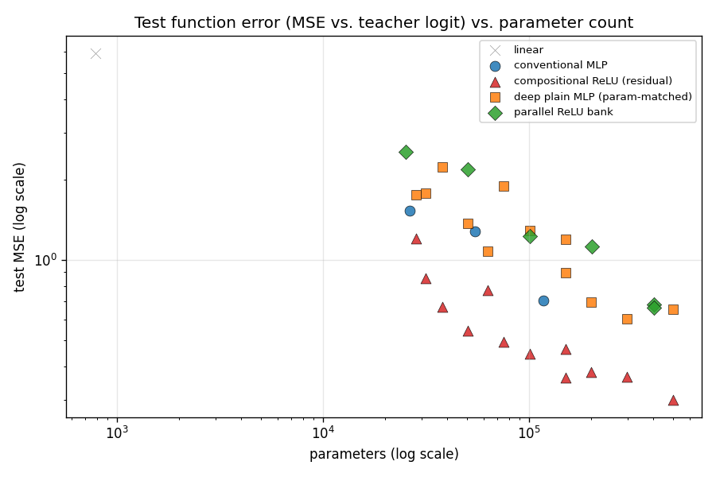
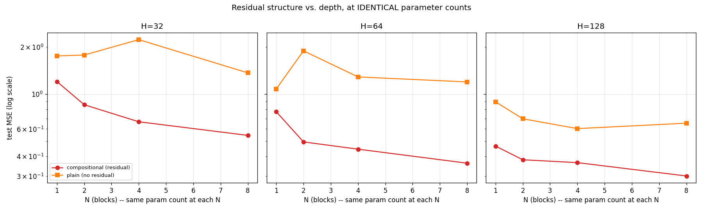

# Experiment 09 — Function Distillation, Repeated on a Balanced Teacher (MNIST 8-vs-2)

Experiment 05's study, repeated a second way: instead of a harder teacher
(that was [experiment 07](../07_function_distillation_cifar10/)'s angle),
this one uses a *cleaner, more balanced* teacher —
[experiment 08](../08_mnist_cnn_8_vs_2/)'s MNIST "8 vs. 2" CNN, trained on
a genuinely balanced pairwise comparison instead of experiment 04's
imbalanced 8-vs-everything. Same five student architectures, same H×N
grid, same pipeline. Read
[experiment 05's README](../05_function_distillation/README.md) first for
the architecture rationale.

```
image -> frozen MNIST 8-vs-2 CNN -> teacher logit -> [student MLP] -> predicted logit
```

## Why this comparison?

Experiment 07 asked what happens when the teacher's *task* gets harder
(CIFAR-10 photographs vs. MNIST digits). This experiment asks a different
question: what happens when the teacher's *decision boundary* gets
cleaner? A balanced pairwise comparison (8 vs. 2 only) is a narrower,
more specific function than "8 vs. nine other digit shapes" — there's
one boundary to learn, not nine implicit ones bundled into a single
logit. If distillation quality tracks decision-boundary complexity rather
than raw task difficulty, this teacher's function should be *easier* to
distill than experiment 05's, even though the underlying classification
task (distinguishing two specific, visually similar digits) isn't
obviously easier.

## Pipeline

Identical to experiment 05, run against experiment 08's checkpoint:

```bash
python experiments/09_function_distillation_8_vs_2/generate_teacher_dataset.py
python experiments/09_function_distillation_8_vs_2/sweep.py
python experiments/09_function_distillation_8_vs_2/robustness_eval.py
python experiments/09_function_distillation_8_vs_2/worst_case.py --model compositional_H128_N8
python experiments/09_function_distillation_8_vs_2/evaluate_ground_truth.py --model conventional_mlp_H32
python experiments/09_function_distillation_8_vs_2/evaluate_ground_truth.py --model compositional_H128_N8
python experiments/09_function_distillation_8_vs_2/make_plots.py
```

## Results

Full numbers: [outputs/results.csv](outputs/results.csv).




| model | params | ReLU layers | train MSE | val MSE | test MSE | test agreement w/ teacher |
|---|---|---|---|---|---|---|
| linear | 785 | 0 | 5.91 | 5.91 | 5.95 | 0.9616 |
| conventional_mlp_H128 | 117,121 | 2 | 0.61 | 0.76 | 0.71 | 0.9920 |
| deepplain_H128_N8 | 496,897 | 24 | 0.55 | 0.66 | 0.65 | 0.9925 |
| **compositional_H128_N8** | 496,897 | 24 | **0.22** | **0.35** | **0.30** | **0.9960** |
| parallel_B32_W16 | 402,433 | 32 | 0.56 | 0.77 | 0.66 | 0.9920 |

**This is a much easier function to distill than experiment 05's.** The
best model here reaches test MSE 0.30 vs. experiment 05's 1.03 — over 3x
lower — on a *narrower* logit range too (roughly ±22 here vs. ±32 there,
so this isn't just a scaling artifact: 0.30/22² = 0.00062 vs. 1.03/32² =
0.00101, still meaningfully lower). Even the linear baseline does far
better in relative terms (test MSE 5.95 vs. 23.55). A cleaner,
single-boundary decision function is easier for every architecture here to
approximate — including the ones with no right to be good at it.

### The core ablation, replicated — with a twist

Residual composition beats parameter-matched plain depth at **every**
`(H, N)` pair, and the gap is the widest seen across all three
distillation experiments so far — at H=64, N=8, compositional (0.363) beats
plain (1.197) by more than 3x, at identical parameters:

| H | N | params (both) | compositional test MSE | plain test MSE |
|---|---|---|---|---|
| 32 | 8 | 50,497 | 0.55 | 1.37 |
| 64 | 4 | 100,225 | 0.45 | 1.29 |
| 64 | 8 | 150,145 | **0.36** | **1.20 (3.3x worse)** |
| 128 | 4 | 298,753 | 0.37 | 0.60 |
| 128 | 8 | 496,897 | 0.30 | 0.65 |

**The twist:** unlike experiments 05 and 07, the plain model here does
*not* show a clean monotonic "gets worse with more depth" pattern — it's
noisier, with a mid-grid bump (e.g. H=32 peaks at N=4, not N=8; H=64
spikes badly at N=2 then partly recovers) rather than a steady decline.
The conclusion "residual composition beats parameter-matched plain depth"
replicates cleanly a third time; the specific *shape* of the plain model's
degradation curve does not — it's a real, teacher-dependent detail, not a
universal law. Worth remembering before over-fitting a story to the shape
of one curve.

### Parallel bank: closer here, but still behind at matched params

`parallel_bank` is still the weakest family at small-to-mid parameter
budgets, but the gap narrows more than in experiments 05/07 — its largest
config (`parallel_B32_W16`, 402k params, test MSE 0.66) is competitive with
`conventional_mlp_H128` (117k params, 0.71) and `deepplain_H128_N8` (497k
params, 0.65). But at *matched* parameters it's still clearly worse:
`parallel_B4_W32` (100,609 params, MSE 1.23) loses badly to
`compositional_H64_N4` (100,225 params, MSE 0.45) — nearly 3x worse at
essentially identical capacity. The headline finding (composition beats
parallel width at matched params) replicates a third time.

### Robustness

([outputs/robustness_results.csv](outputs/robustness_results.csv)):

| model | clean MSE | translate 2px | rotate 10° | gaussian noise | brightness 1.3x |
|---|---|---|---|---|---|
| linear | 5.88 | 10.41 | 5.85 | 6.32 | 6.50 |
| conventional_mlp_H128 | 0.74 | 2.61 | 1.02 | 1.10 | 0.90 |
| deepplain_H128_N8 | 0.68 | 2.12 | 0.66 | 1.01 | 0.88 |
| **compositional_H128_N8** | **0.31** | **1.48** | **0.45** | 0.93 | **0.35** |
| parallel_B32_W16 | 0.68 | 2.83 | 1.01 | 2.20 | 0.82 |

**Third replication of the same exception.** Compositional wins clean,
translation, rotation, and brightness — but under Gaussian noise, it's
essentially tied with `deepplain_H128_N8` (0.93 vs. 1.01) and no longer
clearly ahead. Three for three now, across MNIST-imbalanced, CIFAR-10, and
MNIST-balanced teachers: Gaussian noise is the one perturbation where the
compositional architecture's clean-function advantage consistently
shrinks or disappears. At this point it's fair to call this a structural
property of the residual-block architecture, not a fluke of any one
teacher.

### Ground-truth task evaluation: both ends of the capacity range

| model | params | test accuracy | precision | recall |
|---|---|---|---|---|
| baseline (majority class) | — | 0.5145 | — | — |
| teacher CNN | 26,401 | 0.9920 | 0.9878 | 0.9959 |
| conventional_mlp_H32 (smallest true MLP) | 26,209 | 0.9796 | 0.9670 | 0.9918 |
| **compositional_H128_N8 (best student)** | 496,897 | **0.9880** | 0.9817 | 0.9938 |

**This is a completely different story from experiment 07's CIFAR-10
case.** There, the smallest MLP kept only 19.8% of the teacher's recall; a
massive collapse. Here, even the *smallest* MLP (26k params — smaller than
the teacher itself) recovers 98.0% test accuracy against the teacher's
99.2%, with recall at 99.18% of the teacher's 99.59%. The largest model
closes the gap further (98.8% accuracy) but there just isn't much gap left
to close. A clean, balanced, single-boundary function is not only easier
to approximate in MSE terms — it's also far more forgiving to distill down
to a small student without losing real task performance.

### Where the student is wrong

`outputs/worst_cases/compositional_H128_N8_worst_cases.png` — the worst
disagreements here are much smaller in absolute magnitude (max |error|
≈2.85, vs. experiment 05's ≈5.47) and are dominated by genuine near-
boundary ambiguity rather than extreme-confidence tail cases: 3 of the top
5 are real classification disagreements, all on 2s or 8s the *teacher
itself* was only mildly confident about (logit magnitude under 1). This
matches the "cleaner decision boundary" story — with only one boundary to
learn and no long confident tail of unambiguous negatives (unlike
experiment 05's "8 vs. nine other digits," most of which are easy
negatives), the hard cases cluster right where you'd expect: genuinely
ambiguous handwriting near the 8/2 boundary.

## Scientific interpretation — a third replication, with a genuine new axis

1. **Residual composition beats parameter-matched plain depth** — yes, a
   third time, with the *widest* margin of the three distillation
   experiments (up to 3.3x at matched params). But the specific "gets
   worse with depth" shape of the plain model's failure does *not*
   replicate here — a reminder that the headline finding is robust, but
   its visual signature isn't guaranteed to look the same on every
   teacher.
2. **Parallel width underperforms composition at matched params** — yes, a
   third time (nearly 3x worse at 100k params).
3. **Gaussian-noise robustness is the one place compositional doesn't
   clearly win** — yes, a third time, now on three unrelated teachers
   (MNIST-imbalanced, CIFAR-10, MNIST-balanced). This is the most
   consistent finding across the whole distillation series.
4. **What's genuinely new here:** decision-boundary cleanliness, not just
   task difficulty, changes how distillable a function is. This teacher is
   *not* obviously an easier classification problem than experiment 05's
   (8 vs. one specific similar-looking digit is arguably harder than 8 vs.
   nine mixed digits) — but its function is dramatically easier to
   distill, and small students lose almost none of its task performance.
   That's the opposite of experiment 07's finding, where a harder task
   made distillation notably less complete. Task difficulty and function-
   representation difficulty are not the same axis.
5. **Overall:** the core structural claims (composition > plain depth,
   composition > parallel width, Gaussian-noise exception) now hold across
   three teachers spanning two datasets and two very different framings of
   "harder." The one dimension that genuinely moved the needle on
   distillation *quality* wasn't task difficulty — it was how clean and
   singular the teacher's decision boundary was.

## Reproducing this

```bash
python experiments/08_mnist_cnn_8_vs_2/train.py                # train the teacher first
python experiments/09_function_distillation_8_vs_2/generate_teacher_dataset.py
python experiments/09_function_distillation_8_vs_2/sweep.py
python experiments/09_function_distillation_8_vs_2/robustness_eval.py
python experiments/09_function_distillation_8_vs_2/worst_case.py --model compositional_H128_N8
python experiments/09_function_distillation_8_vs_2/evaluate_ground_truth.py --model conventional_mlp_H32
python experiments/09_function_distillation_8_vs_2/evaluate_ground_truth.py --model compositional_H128_N8
python experiments/09_function_distillation_8_vs_2/make_plots.py
```

Fixed seed (42) throughout. `outputs/cache/`, `outputs/checkpoints/`, and
`*.pt` files are gitignored and regenerable.

## Things to try

- The plain model's non-monotonic depth curve here (vs. the clean
  degradation in experiments 05/07) deserves a multi-seed check — is it
  noise, or a real teacher-dependent difference?
- A third MNIST pair with a genuinely *harder* visual distinction (e.g.
  4 vs. 9) to separate "balanced" from "clean single boundary" as the
  actual driver of easier distillation.
- Cross-teacher distillation: train a student on 08's 8-vs-2 function AND
  04's 8-vs-rest function jointly, see whether a single student can
  represent both without more total capacity than either alone needed.
