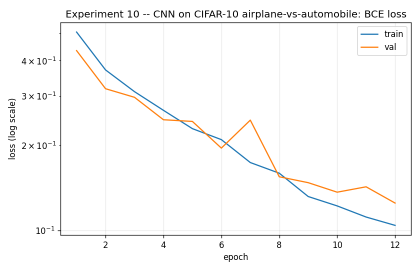
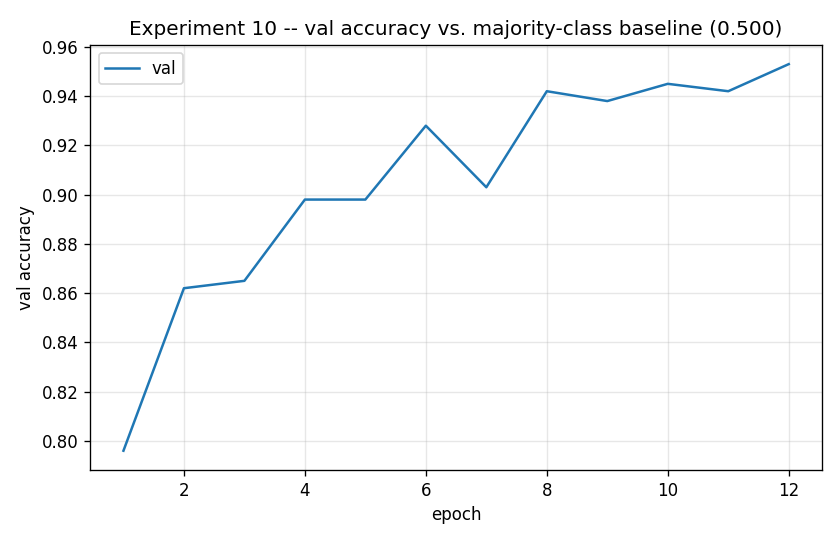
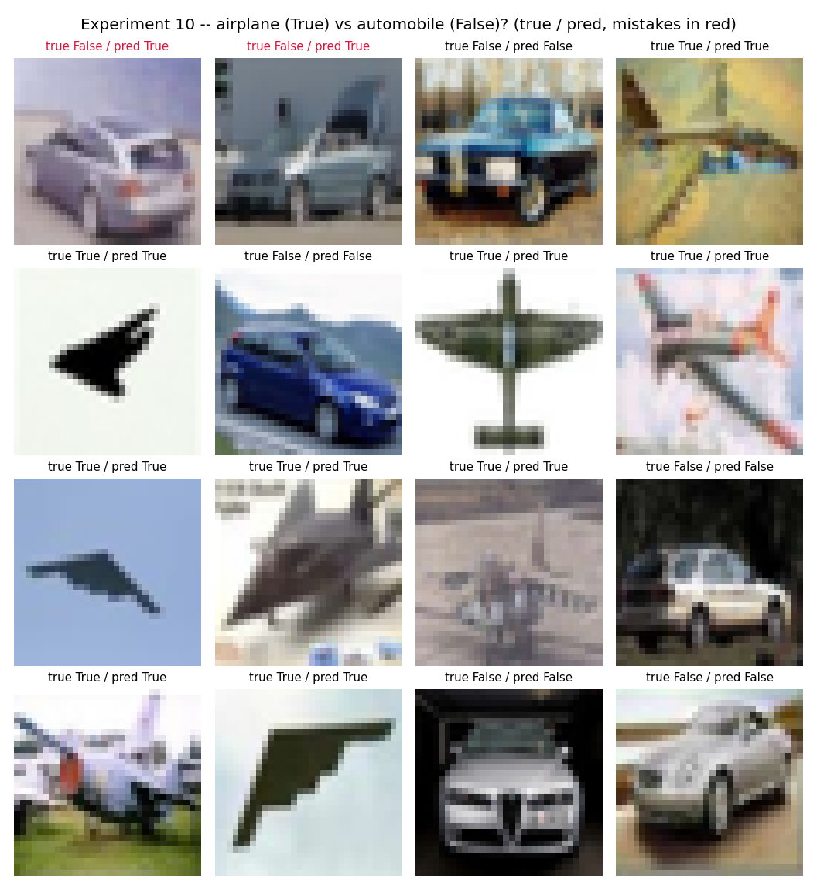

# Experiment 10 — CIFAR-10 CNN: Airplane vs. Automobile

**Question:** Experiment 06 asked "is this an airplane?" across all of
CIFAR-10 — a task where ~90% of images are negatives, so a model that
always says "no" scores ~90% accuracy. This experiment removes that
shortcut: the dataset is filtered down to **only** airplane and automobile
images before training, a perfectly balanced 5,000/5,000 split (1,000/1,000
test). A model that always guesses one class now scores 50%, not 90%.

Airplane and automobile were picked deliberately: both are usually
photographed against a relatively clean, contrasty background (sky / road)
and are rigid, elongated man-made objects — a plausibly *easier* pair to
separate than something like cat vs. dog, but a genuinely balanced one
either way.

## Setup

| | |
|---|---|
| **Model** | Identical to experiment 06: `Conv(3→16,3×3) → ReLU → MaxPool(2) → Conv(16→32,3×3) → ReLU → MaxPool(2) → Conv(32→64,3×3) → ReLU → MaxPool(2) → Flatten → Linear(1024→64) → ReLU → Linear(64→1)` (89,249 params) |
| **Data** | CIFAR-10 filtered to {airplane, automobile} only. Label = `1` if airplane, else `0`. 9,000 train / 1,000 val / 2,000 test |
| **Loss** | `BCEWithLogitsLoss` · **Optimizer** Adam (lr 1e-3) · **Epochs** 12 |
| **Preprocessing** | `ToTensor()` only, same as experiment 06 |

Same architecture as experiment 06 on purpose — this experiment is about
the *data*, not the model.

## Run

```bash
python experiments/10_cifar10_cnn_airplane_vs_automobile/train.py
```

## Result




| | accuracy | precision | recall |
|---|---|---|---|
| **majority-class baseline** | 0.5000 | — | — |
| **this model (test set)** | 0.9525 | 0.9622 | 0.9420 |



## What to take away

- **A much bigger jump than experiment 06's.** Removing the imbalance
  shortcut and narrowing to a visually easier pair (airplane vs.
  automobile, both rigid objects on clean backgrounds) lifts test accuracy
  from 94.9% (experiment 06, airplane-vs-everything) to 95.3% here — a
  smaller gain than MNIST's balanced version saw, but recall improves far
  more dramatically: 0.57 → 0.94. Airplane-vs-rest included visually
  confusing negatives (birds, ships against sky/water); airplane-vs-
  automobile doesn't.
- **Precision and recall are both meaningfully informative here**, unlike
  experiment 08's MNIST case where they barely added anything beyond
  accuracy. CIFAR-10 photographs are noisy enough that even a balanced
  task leaves real precision/recall trade-offs to see.
- **Same lesson as experiment 08, different degree:** balancing the task
  helps recall the most when the original imbalanced task's negatives
  included the specific kind of "hard negative" (birds/ships look sky-or-
  water-adjacent like airplanes) that confused the model — removing those
  negatives entirely, not just balancing the ratio, is doing real work
  here.

## Things to try

- A harder CIFAR-10 pair — e.g. cat vs. dog — to see whether visual
  similarity (not just class imbalance) is the bigger driver of difficulty.
- Compare this model's mistakes to experiment 06's false negatives on
  airplane: are they the *same* airplane images, or does removing
  bird/ship negatives change which airplanes get missed?

## The arc so far

| | model | data | outcome |
|---|-------|------|---------|
| 06 | 3-block CNN | CIFAR-10, airplane-vs-rest (imbalanced ~90/10) | 94.9% accuracy vs. 90.0% baseline, recall 0.57 |
| **10** | 3-block CNN | CIFAR-10, airplane-vs-automobile only (balanced ~50/50) | 95.3% accuracy vs. 50.0% baseline, recall 0.94 |

This CNN is the frozen teacher for
[experiment 11](../11_function_distillation_airplane_vs_automobile/), which
repeats experiment 07's function-distillation study against a genuinely
balanced, easier-negative teacher instead of the imbalanced one.
