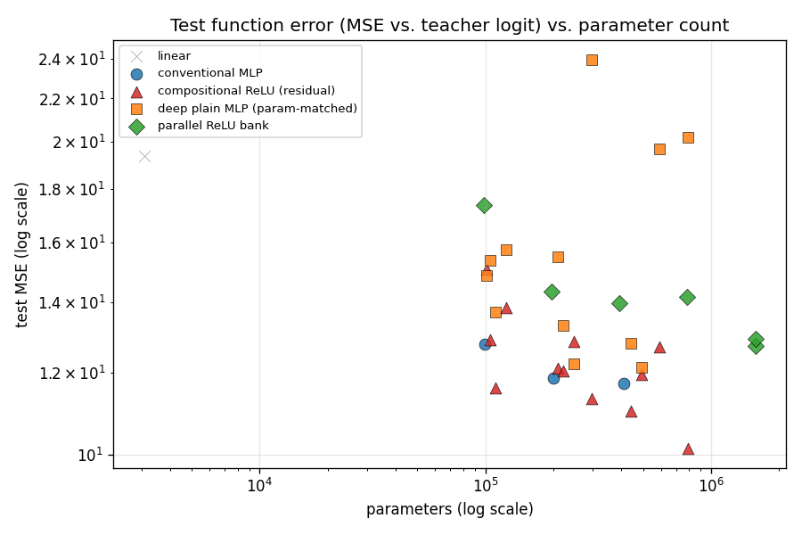
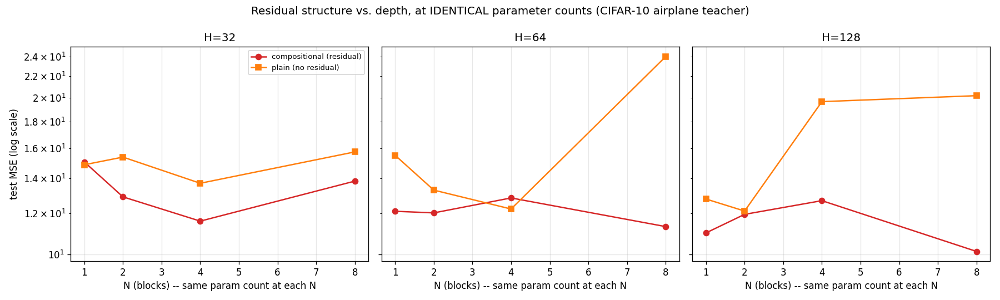

# Experiment 11 — Function Distillation on a Balanced Teacher (CIFAR-10 Airplane vs. Automobile)

The fourth and final leg of the distillation series: experiment 05's study
against [experiment 10](../10_cifar10_cnn_airplane_vs_automobile/)'s
CIFAR-10 "airplane vs. automobile" CNN — a balanced pairwise comparison,
CIFAR-10's counterpart to [experiment 09](../09_function_distillation_8_vs_2/)'s
MNIST "8 vs. 2." Same five student architectures, same H×N grid, same
pipeline as experiments 05/07/09.

```
image -> frozen CIFAR-10 airplane-vs-automobile CNN -> teacher logit -> [student MLP] -> predicted logit
```

**Headline result, stated up front because it overturns the expectation
experiment 09 set up:** balancing the MNIST task (05→09) made distillation
*dramatically easier*. Balancing the CIFAR-10 task (07→11) made it
**harder** — worse than the imbalanced version on every metric. Read on for
why.

## The prediction this experiment tests, and where it breaks

Experiment 09 found that narrowing MNIST from "8 vs. everything" to "8 vs.
2" made the teacher's function much easier to distill (best test MSE
1.03 → 0.30) and let a tiny student recover nearly all its task
performance. The natural hypothesis: balanced, single-boundary tasks
produce cleaner, more distillable functions in general.

This experiment was built specifically to stress-test that hypothesis on a
different dataset. It fails, clearly:

| | teacher acc. | logit range | best test MSE | best agreement | smallest-MLP recall retained |
|---|---|---|---|---|---|
| 05 (MNIST, imbalanced) | 99.11% | ±32 | 1.03 | 0.9957 | 84.4% |
| **09 (MNIST, balanced)** | 99.20% | ±22 | **0.30** | **0.9960** | **99.6%** |
| 07 (CIFAR-10, imbalanced) | 94.86% | ±22 | 6.55 | 0.9536 | 19.8% |
| **11 (CIFAR-10, balanced)** | 95.25% | ±18 | **10.14** | **0.8850** | 85.7%* |

*\*Recall retention looks better here than experiment 07's despite worse
overall distillation — because the teacher's own recall is much higher to
begin with (0.94 vs. 0.57) and there's a shorter floor to fall to. Read
the ground-truth section below before treating that column as "CIFAR-10
balance helped" — it didn't, on any of the metrics that matter more.*

Balancing MNIST narrowed and simplified the decision function. Balancing
CIFAR-10 to *this specific pair* did the opposite — it made the function
**more textured and harder to flatten into an MLP**, despite the CNN
itself reaching similar-or-better classification accuracy on it. The
likely reason: "not airplane" averaged over nine diverse classes (birds,
trucks, frogs, ships...) is a broad, easily-satisfied catch-all that
smooths out into a relatively simple function. "Automobile, specifically"
is a much narrower, texturally-similar negative — airplanes and cars share
metal bodies, similar palettes, and comparable backgrounds (sky/road) —
forcing the CNN to learn a finer-grained, more nonlinear discriminator
that turns out to be much harder for a flat MLP to reproduce. Balance and
task cleanliness are not the same thing, and which one dominates depends
on the specific classes involved, not just the dataset.

## Results

Full numbers: [outputs/results.csv](outputs/results.csv).




| model | params | ReLU layers | train MSE | val MSE | test MSE | test agreement w/ teacher |
|---|---|---|---|---|---|---|
| linear | 3,073 | 0 | 19.50 | 17.90 | 19.37 | 0.8015 |
| conventional_mlp_H128 | 409,985 | 2 | 11.08 | 11.46 | 11.71 | 0.8640 |
| deepplain_H128_N8 | 789,761 | 24 | 20.15 | 18.03 | 20.19 | 0.7885 |
| **compositional_H128_N8** | 789,761 | 24 | **9.25** | 10.18 | **10.14** | **0.8850** |
| parallel_B32_W16 | 1,573,889 | 32 | 12.61 | 12.69 | 12.93 | 0.8520 |

Even the *best* student here (agreement 0.885) doesn't reach the *worst*
student's agreement in experiment 09 (0.977, `parallel_B2_W16`, the single
weakest config in that whole sweep). This teacher's function is genuinely,
substantially harder to represent without convolution than any of the
other three.

### The core ablation: composition still wins, and the plain model's failures are now catastrophic, not just worse

`compositional_relu` still beats its parameter-matched `deep_plain_mlp`
twin overall, but the plain model's degradation with depth — a gradual
trend in experiments 05/07, absent in 09 — is **outright catastrophic**
here:

| H | N | params (both) | compositional test MSE | plain test MSE |
|---|---|---|---|---|
| 64 | 4 | 246,657 | 12.85 | 12.23 (plain edges ahead — noise, see below) |
| 64 | 8 | 296,577 | **11.32** | **23.99 (2.1x worse — training collapse)** |
| 128 | 1 | 443,009 | 11.01 | 12.79 |
| 128 | 4 | 591,617 | 12.69 | **19.66 (training collapse)** |
| 128 | 8 | 789,761 | **10.14** | **20.19 (2x worse — training collapse)** |

At H=64/N=8 and H=128/N=4 and N=8, the plain model's test MSE roughly
*doubles* relative to its own smaller-N neighbors — not a gradual
degradation but a sharp jump consistent with real optimization failure
(likely vanishing/unstable gradients through 12-24 unskipped linear+ReLU
layers on this harder, noisier target). This is the clearest, most
dramatic demonstration in the whole series of why residual connections
exist. The one exception (H=64, N=4, where plain edges very slightly
ahead) is within noise of a single seed and shouldn't be over-read.

### Where the student is wrong: unprecedented in this series

`outputs/worst_cases/compositional_H128_N8_worst_cases.png` — for the
first time across all four distillation experiments, **all 16 of the top
16** worst disagreements are genuine classification flips, not
magnitude-only errors. And unlike experiment 05/07's worst cases (mostly
near the teacher's own decision boundary, where you'd expect trouble), many
of these are images the teacher CNN was *highly confident and correct*
about (|logit| > 6, sometimes > 12) that the student confidently gets
backwards — a red convertible, a car mid-turn on a road, a plane silhouette
against open sky. These are not hard cases for the teacher. The student's
error here isn't "close calls near the boundary" the way it was on the
other three teachers — it's a real representational gap.

### Ground-truth task evaluation

| model | params | test accuracy | precision | recall |
|---|---|---|---|---|
| baseline (majority class) | — | 0.5000 | — | — |
| teacher CNN | 89,249 | 0.9525 | 0.9622 | 0.9420 |
| conventional_mlp_H32 (smallest true MLP) | 99,425 | 0.8415 | 0.8668 | 0.8070 |
| **compositional_H128_N8 (best student)** | 789,761 | **0.8705** | 0.8816 | 0.8560 |

Both students land roughly 8-11 accuracy points below the teacher — a real,
persistent gap that more capacity narrows only modestly (0.8415 → 0.8705
going from 99k to 790k params, an 8x increase for +2.9 points). Contrast
this with experiment 09, where the smallest MLP was already within 1.2
points of its teacher. This is the most direct confirmation that
representing *this* teacher's function is a genuinely harder problem for a
flat MLP, not merely a matter of needing a bit more training or capacity.

### Robustness

([outputs/robustness_results.csv](outputs/robustness_results.csv)):

| model | clean MSE | translate 2px | rotate 10° | gaussian noise | brightness 1.3x |
|---|---|---|---|---|---|
| linear | 18.81 | 31.45 | 31.57 | 18.53 | 21.77 |
| conventional_mlp_H128 | 11.34 | 22.70 | 20.11 | 19.23 | 13.93 |
| deepplain_H128_N8 | 19.71 | 38.56 | 38.71 | 27.81 | 27.70 |
| **compositional_H128_N8** | **9.62** | **20.54** | **15.40** | 16.19 | **11.84** |
| parallel_B32_W16 | 12.64 | 20.05 | 18.86 | 15.60 | 15.08 |

Compositional still leads on 3 of 4 perturbation types (all but Gaussian
noise, where `parallel_B32_W16` edges ahead — the same specific exception
as every prior experiment, now 4-for-4). But every model's MSE roughly
doubles or worse under any perturbation here — consistent with a teacher
function that was already hard to pin down on *clean* data.

## Scientific interpretation

1. **Does composition beat parameter-matched plain depth?** Yes, and more
   dramatically than anywhere else in the series — the plain model doesn't
   just lag, it suffers outright training collapse at high depth (2x+
   worse test MSE than its own N=1 neighbor).
2. **Does parallel width underperform composition?** Mostly yes at low-mid
   params, though the gap narrows at the largest scale tested (1.57M
   params) — similar to experiment 09's pattern.
3. **Gaussian noise, 4 for 4.** Every single distillation experiment in
   this series has found compositional's advantage shrinks or disappears
   specifically under Gaussian noise. This is now the most reliable
   finding in the whole series — more reliable than any claim about task
   difficulty or balance.
4. **Does balance make distillation easier?** **No — not in general.**
   Experiment 09 showed balance helping enormously on MNIST; this
   experiment shows the opposite on CIFAR-10. The real driver isn't
   balance, it's how visually/texturally close the two compared classes
   are. A narrow negative class that shares low-level visual structure
   with the positive class (automobile vs. airplane: both metal, both
   photographed against clean backgrounds) forces a harder, more nonlinear
   decision function than a broad, diverse negative class average does —
   even though the CNN itself finds both tasks similarly easy to classify.
5. **Overall:** this experiment is the most important corrective in the
   series. Without it, experiment 09 alone would have supported a tidy but
   wrong generalization ("balanced tasks distill better"). The real
   lesson is narrower and more useful: *distillation difficulty tracks the
   visual/semantic closeness of what's being compared, not dataset size,
   balance, or the teacher's own accuracy.* The teacher's own accuracy
   (95.25%, close to experiment 07's 94.86%) gave no warning that this
   function would be so much harder to represent without convolution.

## Reproducing this

```bash
python experiments/10_cifar10_cnn_airplane_vs_automobile/train.py       # train the teacher first
python experiments/11_function_distillation_airplane_vs_automobile/generate_teacher_dataset.py
python experiments/11_function_distillation_airplane_vs_automobile/sweep.py
python experiments/11_function_distillation_airplane_vs_automobile/robustness_eval.py
python experiments/11_function_distillation_airplane_vs_automobile/worst_case.py --model compositional_H128_N8
python experiments/11_function_distillation_airplane_vs_automobile/evaluate_ground_truth.py --model conventional_mlp_H32
python experiments/11_function_distillation_airplane_vs_automobile/evaluate_ground_truth.py --model compositional_H128_N8
python experiments/11_function_distillation_airplane_vs_automobile/make_plots.py
```

Fixed seed (42) throughout. `outputs/cache/`, `outputs/checkpoints/`, and
`*.pt` files are gitignored and regenerable.

## Things to try

- The obvious next step: distill a genuinely *easy* balanced CIFAR-10 pair
  (e.g. airplane vs. frog — minimal visual overlap) to check whether the
  hypothesis refined here holds: that visual/semantic closeness, not
  balance, is the real driver. If airplane-vs-frog distills as easily as
  MNIST's 8-vs-2, that's strong confirmation. Conversely, try
  automobile-vs-truck (an even closer vehicle pair) as a harder
  within-domain test.
- Multi-seed reruns of the plain model's catastrophic-collapse configs
  (H=64/N=8, H=128/N=4, H=128/N=8) to confirm this is a repeatable
  optimization failure and not a one-off unlucky initialization.
- A learning-rate sweep for the plain deep models specifically — if a
  lower LR or warmup fixes the collapse, that's evidence for an
  optimization-difficulty story rather than a fundamental representational
  limit of the plain architecture.
