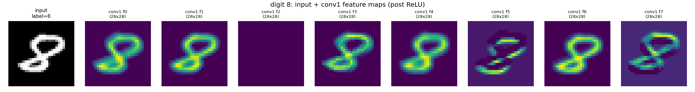
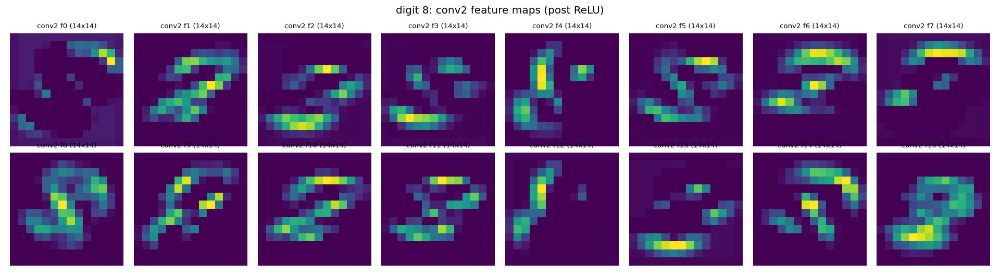
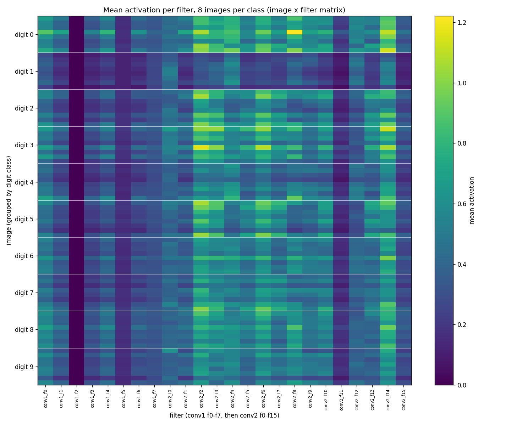
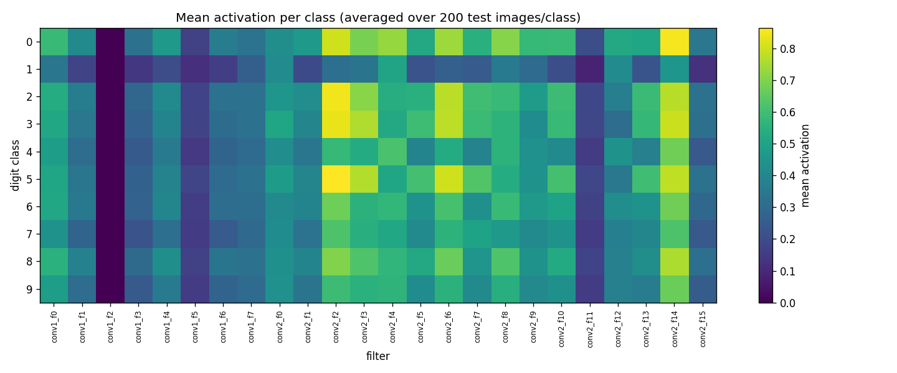
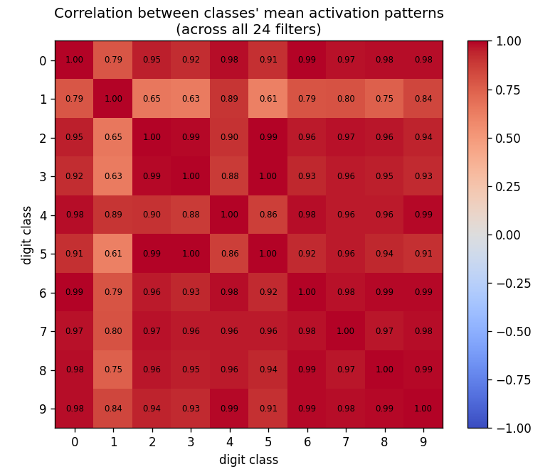
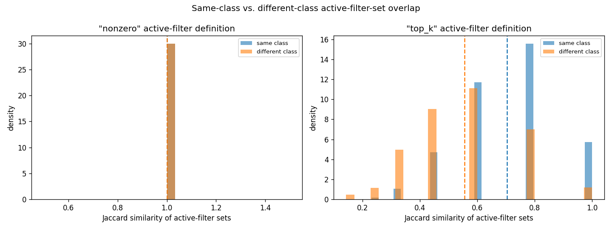
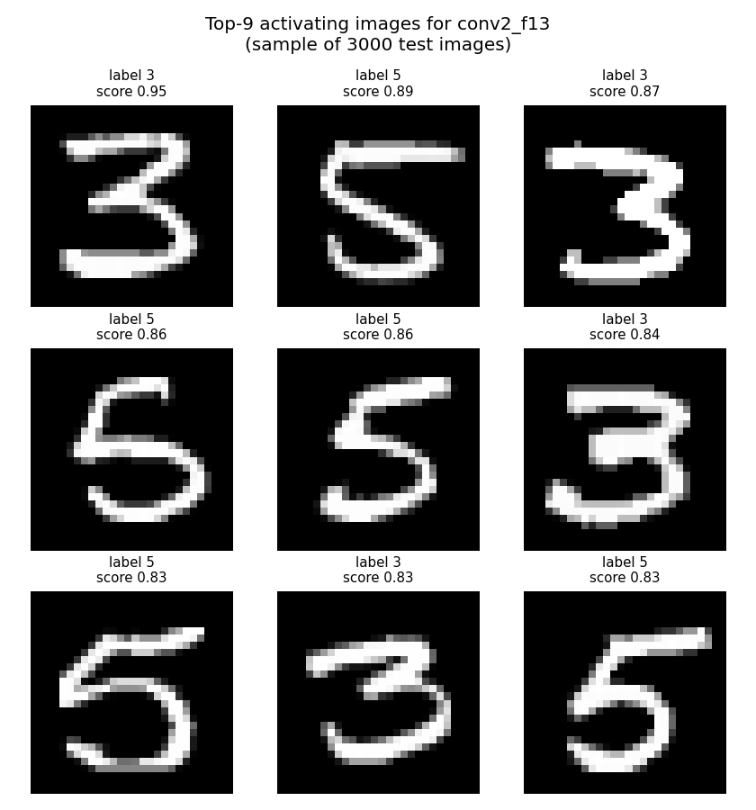
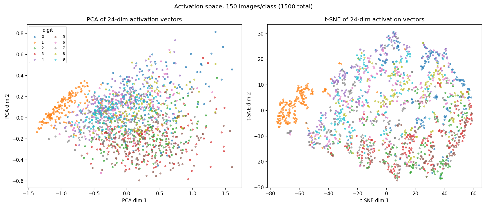
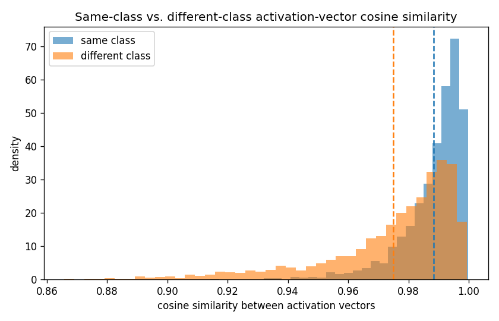

# Experiment 12 — Do Different Inputs Activate Different Subsets of CNN Filters?

**Hypothesis under test:** different input images activate different
subsets of convolutional filters, even though the same learned weights are
applied to every image.

This is an interpretability experiment, not a classification one. The CNN
(10-way MNIST digit classifier, 98.19% test accuracy) exists only as a
subject to inspect — the actual question is about the distinction between
two things that are easy to conflate:

- **Weights / filters** — `model.conv1.weight`, `model.conv2.weight`: fixed
  learned parameters. They do not change during inference, for any input.
- **Activations / feature maps** — the *output* a filter produces for a
  *specific* input. These are recomputed from scratch every forward pass
  and are different for every image.

Every claim below is checked against actual run output, not asserted from
theory. Full deliverables (code, plots, raw numbers) live in this folder
and `outputs/`.

## Model

```
Conv2d(1→8, 3×3, pad=1) → ReLU → MaxPool(2)    # 28×28 → 14×14, 8 filters ("conv1")
Conv2d(8→16, 3×3, pad=1) → ReLU → MaxPool(2)   # 14×14 → 7×7, 16 filters  ("conv2")
Flatten → Linear(784→32) → ReLU → Linear(32→10)
```

26,698 params, trained 5 epochs, Adam, seed 42 → **98.19% test accuracy**
(per-class range 95.2%–99.5%, no lopsided class). `model.py` / `train.py`.

Every filter gets a stable global index used throughout: `conv1_f0`…`conv1_f7`
(28×28 feature maps), `conv2_f0`…`conv2_f15` (14×14 feature maps) — 24
filters total.

**One honest wrinkle found immediately and kept visible throughout:**
`conv1_f2` is a dead filter — zero activation for every image tested, no
exceptions. It's excluded from every statistic where a zero-variance
filter would produce a degenerate result (flagged explicitly wherever that
happens), rather than silently dropped or hidden.

## Experiment 6 — weight invariance (checked first, since everything else depends on it)

`exp6_weight_invariance.py`: snapshots `conv1`/`conv2` weights and biases,
runs image A (a "3"), snapshots again, runs image B (a "7"), snapshots
again, diffs every pair.

```
max |weight difference| before inference vs. after running image A = 0.0
max |weight difference| after image A vs. after image B            = 0.0
max |weight difference| before inference vs. after running image B = 0.0

mean |activation difference| across all 24 filters = 0.2304
max  |activation difference| (single filter)        = 0.5470
filters differing by > 1e-4: 23 / 24
```

Bit-for-bit identical weights, mechanically confirmed — not assumed —
across two forward passes on different inputs, while 23 of 24 filters'
activations differ substantially. This is the premise everything else
rests on, and it holds exactly.

## Experiment 1 — feature map visualization

`exp1_feature_maps.py` → `outputs/feature_maps/digit_{0-9}_conv{1,2}.png`.




conv1's 8 feature maps mostly look like edge/stroke detectors — several
respond to the loop structure generically, one or two pick out different
contrast/orientation. conv2's 16 feature maps are visibly more localized
and varied: some fire on the top curve, some on the bottom loop, some on
specific corner regions. This is a qualitative read, offered cautiously —
"this filter responds to the top-left corner of an 8" is a description of
what lit up on *this* image, not a proven general semantic role (that's
what experiment 5's top-k search is for).

## Experiment 2 — the image × filter matrix

`exp2_activation_matrix.py` → `outputs/exp2_activation_matrix.png`. 8
images per class, all 24 filters, rows grouped and separated by class.



Visible banding by class (e.g. digit 0/3 rows run brighter on several
columns than digit 1 rows) — the first direct evidence, before any
statistics, that images produce systematically different activation
*rows*. A quick variance-ratio check (fraction of each filter's variance
explained by class, computed properly excluding the dead filter) finds
several filters where class explains 60%+ of the variance in this sample
— formalized properly in experiment 3.

## Experiment 3 — class-level patterns, quantified

`exp3_class_activation.py`, 200 images/class (2,000 total).



One-way ANOVA per filter (class as the grouping variable):

```
23 / 23 live filters show class-dependent mean activation at p < 0.001
(conservative Bonferroni threshold for 23 tests: p < 0.0022 — still 23/23 pass)
```

Effect sizes (η²) range from 0.16 (`conv2_f0`, weakest) to 0.62
(`conv1_f5`, strongest) — every filter's activation depends on class to
*some* measurable degree; the degree varies a lot.



The 10×10 correlation matrix between classes' mean activation *patterns*
(not raw activation — the shape of relative engagement across all 24
filters) is uniformly high: mean off-diagonal r = 0.915. **Most similar
pair: digits 3 & 5 (r=0.997). Most different: digits 1 & 5 (r=0.614).**
This is an important, non-obvious nuance: classes are statistically
distinguishable (per the ANOVA) but not close to *orthogonal* in
activation-pattern space — they mostly engage the same filters to
different degrees, not disjoint filter sets. Digit 1's minimal, low-ink
strokes make it the standout outlier from everything else.

## Experiment 4 — active *subsets*, not just magnitudes (the sharpest test)

`exp4_active_filter_overlap.py`. This is the test that actually
distinguishes "different magnitudes on the same filters" from "different
*subsets* of filters" — the literal hypothesis. Two active-filter
definitions, both reported honestly because the first one turned out to
be useless:

```
--- "nonzero" (mean activation > 0) ---
active filters per image: 23.00 +/- 0.00 (of 24)
same-class Jaccard similarity:      1.0000 +/- 0.0000
different-class Jaccard similarity: 1.0000 +/- 0.0000
Mann-Whitney U test: p = 1.00  (no difference — as expected)

--- "top_k" (top 8 of 24 filters by mean activation) ---
active filters per image: 8.00 +/- 0.00 (of 24)
same-class Jaccard similarity:      0.7035 +/- 0.1748
different-class Jaccard similarity: 0.5555 +/- 0.1809
Mann-Whitney U test (same > different): U=6,431,216, p = 5.30e-195
```



The naive "active = nonzero" threshold is degenerate: with ReLU and only
one genuinely dead filter, essentially every image lights up all 23 live
filters *somewhere*, so every pair looks identical (Jaccard=1.0 for
everyone) — this null result is reported, not hidden, because it's an
important negative finding about threshold choice, not just noise. The
stricter "top-8" threshold gives the real answer: **same-class image
pairs share 70% of their top-8 most-active filters on average; different-
class pairs share only 56%** — a large, statistically overwhelming
difference (p ≈ 5×10⁻¹⁹⁵ on ~6,000 sampled pairs). But note the
different-class baseline (0.56) is still well above 0 — consistent with
experiment 3's finding that classes share most of the same filters at
different degrees, rather than using cleanly disjoint sets.

## Experiment 5 — what does each filter prefer?

`exp5_top_activating_images.py` → `outputs/top_activating/`, 8
representative filters (4 conv1, 4 conv2), top-9 activating images from a
3,000-image sample each.



`conv2_f13`'s top-9 images are `[3,3,3,3,5,5,5,5,5]` — exclusively 3s and
5s, exactly the pair experiment 3 found most correlated (r=0.997) and
most confused with each other in class-mean activation. `conv1_f5`'s
top-9 are similarly dominated by 3s and 5s. `conv1_f0`/`conv1_f1` favor
0s and 8s (full closed loops). This is a genuinely convergent finding
across three independent analyses (correlation, ANOVA-implied similarity,
and direct top-k search) — strong evidence, not a coincidence.

**Caveat kept visible rather than glossed over:** mean-activation top-k
search is confounded by total "ink area" — bold, thick-stroke digits with
more foreground pixels tend to win regardless of shape, since mean
activation sums over more nonzero locations. The 3-vs-5 finding is
probably real (it replicates three ways), but "this filter detects 0s and
8s" claims from this experiment alone should be read as "this filter
responds most to bold, loopy digits," not a proven shape-specific
detector — disentangling shape-selectivity from stroke-thickness would
need a follow-up controlling for ink area.

## Experiment 7 — activation space

`exp7_activation_space.py` → `outputs/activation_space/`. Every sampled
image reduced to its 24-dim mean-activation vector; PCA and t-SNE to 2D.



```
PCA: explained variance ratio (PC1, PC2) = [0.803, 0.123]
```

Digit 1 forms a strikingly clean, separated cluster in *both* projections
— consistent with it being the "most different" class from experiment 3.
Other classes show partial regional clustering (3/5/8 group loosely in
one region of the t-SNE plot, 0/4/9 in another) but with real overlap, not
clean separation — matching the "graded, overlapping" picture from
experiments 3-4, not a "each class gets its own isolated region" one.
PC1 alone explains 80% of variance — almost certainly a general
activation-magnitude / ink-area axis (see experiment 5's caveat), not a
shape-identity axis.



```
same-class cosine similarity:      0.9885 +/- 0.0106
different-class cosine similarity: 0.9749 +/- 0.0222
Mann-Whitney U (same > different): p ≈ 0
```

Statistically overwhelming, but both numbers are close to 1.0 — the 24-dim
activation vectors mostly point in similar directions overall (again, the
shared magnitude/ink-area component dominates), with class membership
producing a real but comparatively small additional pull.

## Final interpretation

### To what extent does this experiment support the hypothesis?

**Supported, with an important qualification the data itself surfaced:**
different images do activate different filters, in both magnitude (exp.
2-3, quantified via ANOVA, all live filters p<0.001) and in *which subset*
counts as most-active (exp. 4, top-8 Jaccard 0.70 same-class vs. 0.56
different-class, p≈5×10⁻¹⁹⁵). This is not merely "the numbers are a bit
different" but a large, statistically robust, multiply-convergent
effect (the same 3-vs-5 pattern shows up independently in the class
correlation matrix, the ANOVA effect sizes, and the raw top-9 image
search). But the *qualification* matters as much as the headline: classes
are not using disjoint filter sets. Even different-class pairs share the
majority (56%) of their top-active filters, and class-pattern correlations
never drop below 0.61. The honest summary is **"same filters, engaged to
different, statistically distinguishable, but substantially overlapping
degrees"** — not "each class recruits its own private set of filters."

### What was directly demonstrated

- Weights are bit-for-bit invariant across different inputs (exp. 6,
  mechanically verified, not assumed).
- Filter activation magnitude depends on input class, for every live
  filter, at high statistical significance (exp. 3).
- The *set* of top-8-most-active filters overlaps significantly more
  within a class than between classes (exp. 4), directly addressing the
  hypothesis as literally stated.
- Specific filters (e.g. `conv1_f5`, `conv2_f13`) preferentially respond
  to a specific, consistent visual pattern (bold curved strokes shared by
  3s and 5s), found convergently by three independent methods.
- One filter (`conv1_f2`) never activates for any input tested — a
  concrete example of the training process leaving representational
  capacity completely unused ("dead ReLU").

### What was only suggested, not proven

- That specific filters "detect" specific semantic shapes (e.g. "loop
  detector," "hook detector") — plausible from the top-k image evidence
  but confounded with total ink/stroke area, never isolated as a pure
  shape-selectivity effect.
- That the PCA/t-SNE clustering reflects class identity specifically
  rather than a correlated nuisance variable (stroke boldness/coverage)
  that happens to vary by class too — PC1 explaining 80% of variance is
  more consistent with a magnitude axis than an identity axis.

### What cannot be concluded from this experiment

- Whether this pattern holds for a deeper or differently-trained network —
  everything here is specific to this one small, 2-conv-layer CNN.
- Whether individual filters are causally necessary for classifying
  specific classes (this experiment is observational/correlational —
  no ablation was run to test what happens if a "3/5 filter" is zeroed
  out).
- Anything about *why* training converged to this particular allocation of
  filters to patterns, or whether a different seed/initialization would
  produce a similar or very different filter-to-pattern mapping.

### Filter specialization vs. conditional/dynamic routing

These are easy to conflate and worth being precise about, since they'd
imply very different mechanisms:

- **Filter specialization** (what this experiment found): every filter is
  applied to every input, unconditionally — there is no branching, no
  input-dependent selection of *which* computation runs. What varies is
  the *output* each fixed computation happens to produce, and different
  filters happen to have learned to produce large outputs for different
  input patterns. The "specialization" is a statistical property of the
  learned weights (this filter's kernel happens to resemble the stroke
  pattern of 3s and 5s), not a control-flow decision.
- **Conditional / dynamic routing** (NOT what this experiment tested or
  found): an architecture where the computation graph itself changes per
  input — e.g. a mixture-of-experts layer that only evaluates a subset of
  sub-networks per input, or an early-exit network that skips layers
  based on a learned gate. This CNN has no such mechanism: `forward()`
  always calls `conv1` then `conv2`, in full, for every input, and
  experiment 6 confirms the weights used are identical regardless. Nothing
  here is "routed" — everything runs every time; only the *output* differs.

The result of this experiment is squarely the first kind. Nothing was
observed, measured, or could have been measured with this architecture
that constitutes dynamic routing.

## Reproducing this

```bash
python experiments/12_cnn_filter_activations/train.py
python experiments/12_cnn_filter_activations/exp6_weight_invariance.py
python experiments/12_cnn_filter_activations/exp1_feature_maps.py
python experiments/12_cnn_filter_activations/exp2_activation_matrix.py
python experiments/12_cnn_filter_activations/exp3_class_activation.py
python experiments/12_cnn_filter_activations/exp4_active_filter_overlap.py
python experiments/12_cnn_filter_activations/exp5_top_activating_images.py
python experiments/12_cnn_filter_activations/exp7_activation_space.py
```

Fixed seed (42) throughout. `outputs/model.pt` is gitignored and
regenerable from `train.py`; every plot, heatmap, and text summary under
`outputs/` is committed so results render on GitHub without rerunning
anything.

## Things to try

- **Ablation, to move from correlational to causal:** zero out
  `conv2_f13` specifically and measure the accuracy drop on 3s and 5s
  specifically vs. other classes — would directly test whether the
  filter-class association found here is load-bearing or incidental.
- **Control for ink area directly:** repeat experiment 5's top-k search
  after normalizing each image's activation scores by its own total
  pixel-on count, to separate genuine shape-selectivity from a
  stroke-thickness confound.
- **A genuine mixture-of-experts or early-exit variant**, trained on the
  same task, to see what conditional/dynamic routing actually looks like
  in the same diagnostic plots — as a contrast case for the distinction
  this README draws conceptually but never gets to observe directly with
  the current architecture.
- Reinitialize and retrain with a different seed, rerun the whole
  pipeline, and check whether `conv1_f2` dying and the 3-vs-5 filter
  specialization are robust findings or artifacts of this one run.
